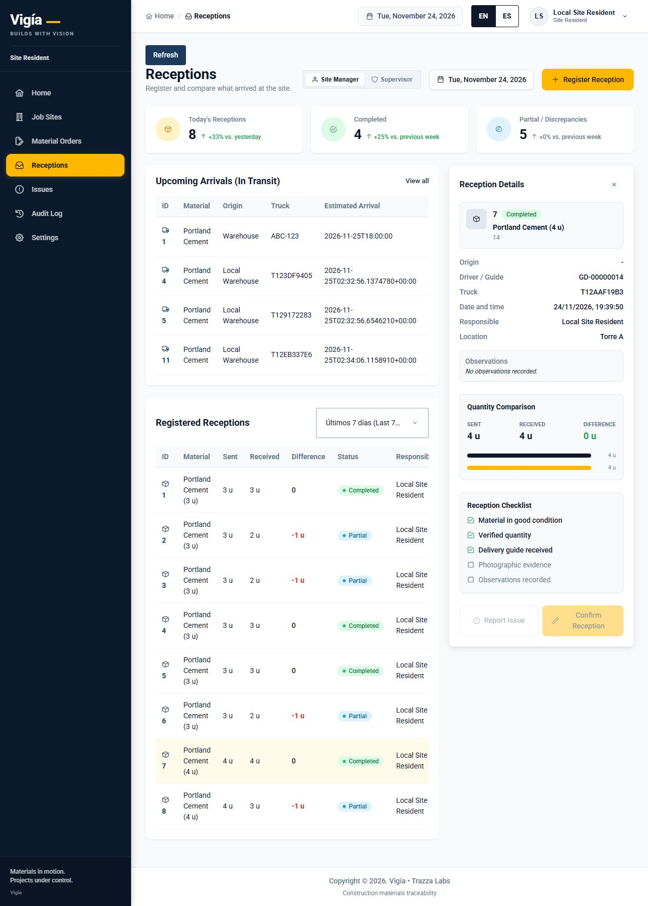
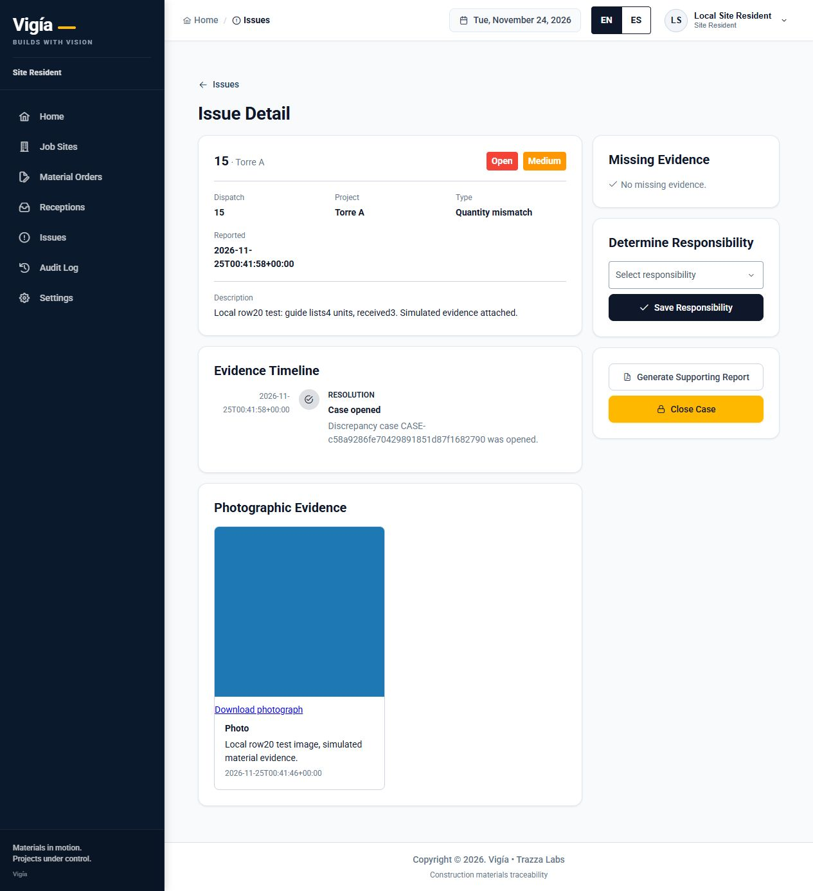
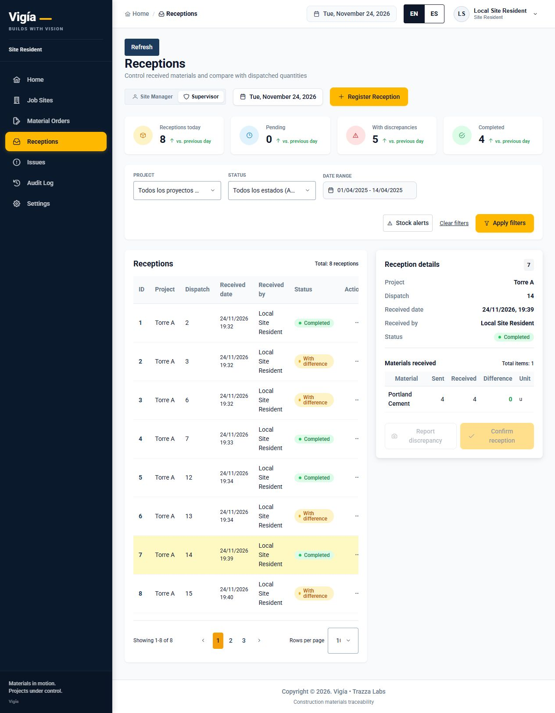
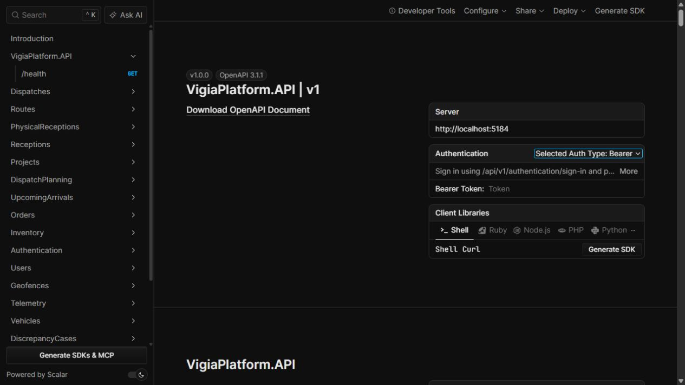
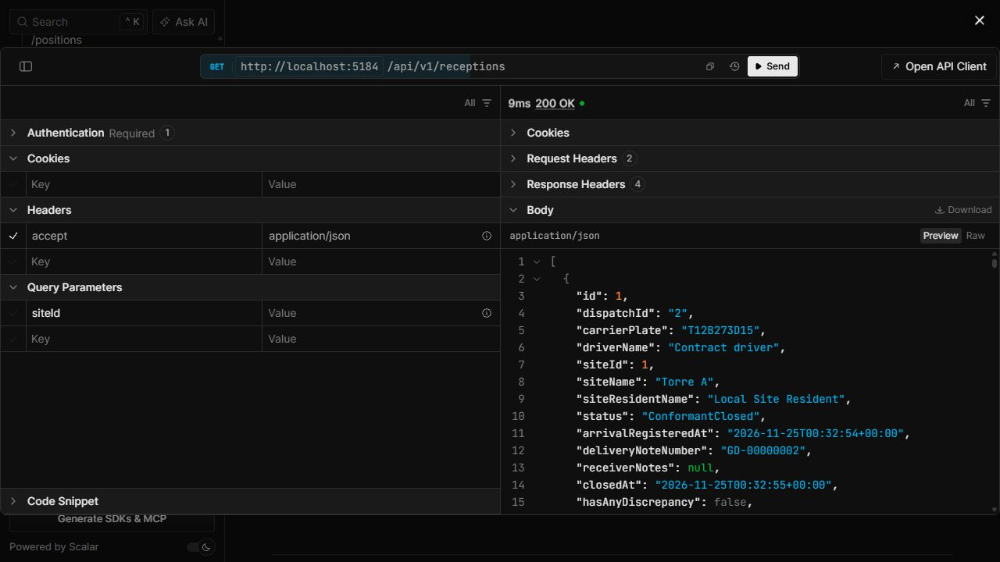
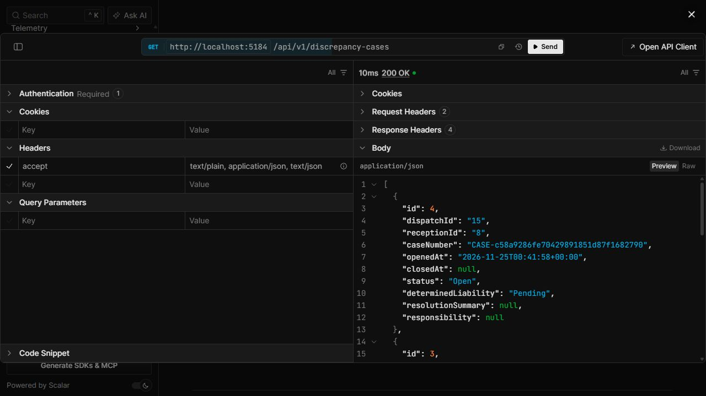

# Evidencia de Recepción y Verificación en Obra — Sprint 4 (Entregable A11)

**Autor:** Cárdenas Huaman, Mathias Andree (`Usuario353`)  
**Bounded Context:** *Site Reception & Verification* (con integración a *Discrepancy & Evidence Management* y *Contact Requests*)  
**Destinatarios de consolidación:** Fabián Sandoval (`S4-09` — Scalar / Servicios), Leonardo López (`S4-12` — Desarrollo y Colaboración) y Elías Ramos (`S4-17` — Ejecución y Navegación).  
**Nota de alcance:** Todas las capturas provienen de la verificación local integrada y aceptada (`docs/evidence/row20/`). Las URLs públicas de producción corresponden al despliegue final en Azure (`S4-10`, fila 21). Se mantiene **Scalar** como interfaz oficial de documentación OpenAPI.

---

## 1. Aporte para `5.2.4.4. Development Evidence for Sprint Review` (`S4-12` — Leonardo)

| Repository | Branch | Commit Id | Commit Message | Commit Message Body / Alcance verificado | Committed on (Date) |
|---|---|---|---|---|---|
| [vigia-platform](https://github.com/upc-pre-202620-1asi0730-8084-Developers/vigia-platform) | `feature/reception-completion` *(integrada en `develop` vía `f385738`)* | `4ce0e05` | `feat(site-reception): enforce project ownership, delivery guide validation and atomic closure` | Autorización por obra asignada (`F13-03`/`F13-07`), validación de guía oficial (`F13-06`), migración EF Core `AddReceptionIdempotencyAndConcurrency` (`Version`, `RegisterRequestId`, `VerifyRequestId`) y cierre atómico recepción + despacho + ruta (`F13-02`). | 24/11/2026 |
| [vigia-platform](https://github.com/upc-pre-202620-1asi0730-8084-Developers/vigia-platform) | `feature/reception-completion` *(integrada en `develop` vía `f385738`)* | `97c6493` | `test(site-reception): use valid order code format in integration checks` | Ajuste del fixture de `VigiaPlatform.IntegrationChecks` al formato válido `SOL-990014` para ejecutar la verificación integral sobre MySQL 8.4. | 24/11/2026 |
| [vigia-platform](https://github.com/upc-pre-202620-1asi0730-8084-Developers/vigia-platform) | `feature/contact-requests` | `62eebfc` | `feat(contact-requests): add public subscription contact endpoint and migration` | Implementación de `POST`/`GET /api/v1/contact-requests` (`TS-06`/`T-15`), migración `AddContactRequests`, política CORS para GitHub Pages y pruebas de validación/idempotencia. | 26/11/2026 |
| [vigia-web-application](https://github.com/upc-pre-202620-1asi0730-8084-Developers/vigia-web-application) | `fix/i18n-map-license` *(integrada en `develop` vía `b1d232b`)* | `10d889e` | `fix(i18n): localize remaining views, add map loading state and production PrimeUI key` | Traducción de vistas restantes, indicador de carga en mapa interactivo y clave PrimeUI en producción. | 21/11/2026 |
| [vigia-web-application](https://github.com/upc-pre-202620-1asi0730-8084-Developers/vigia-web-application) | `feature/reception-completion` *(integrada en `develop` vía `702557c`)* | `15d9bce` | `feat(site-reception): bind authoritative delivery guide, project permissions and idempotent verification` | Bloqueo de guía y despacho emitidos por el servidor, permisos de edición por obra (`canActorEditReception`), recuperación idempotente de `requestId` en `sessionStorage` y recarga real tras cierre. | 24/11/2026 |
| [vigia-web-application](https://github.com/upc-pre-202620-1asi0730-8084-Developers/vigia-web-application) | `feature/reception-evidence-integration` *(integrada en `develop` vía `702557c`)* | `dada9a7` | `feat(evidence): wire idempotent discrepancy verification and protected thumbnails` | Carga previa de fotos protegidas, verificación discrepante idempotente, enlace directo al caso `/problemas/:id` y miniaturas con `<ProtectedEvidencePhoto>`. | 24/11/2026 |
| [vigia-web-application](https://github.com/upc-pre-202620-1asi0730-8084-Developers/vigia-web-application) | `fix/reception-accessibility` | `b0e5145` | `fix(reception): improve keyboard navigation, ARIA semantics, i18n and add A12 checklist` | Navegación por teclado en filas/selectores, ARIA en paneles/alertas, eliminación de enlaces `javascript:void(0)`, filtros bilingües y 4 pruebas automatizadas nuevas (`34/34` en verde). | 26/11/2026 |
| [vigia-website](https://github.com/upc-pre-202620-1asi0730-8084-Developers/vigia-website) | `feature/contact-requests` | `67264a6` | `feat(contact): add subscription contact form connected to Vigia API` | Formulario de contacto accesible ES/EN en `#contacto` conectado a `POST /api/v1/contact-requests` con validación por campo e idempotencia (`LP-04`/`TS-06`). | 26/11/2026 |
| [vigia-report](https://github.com/upc-pre-202620-1asi0730-8084-Developers/vigia-report) | `docs/sprint-4-planning` *(integrada vía [PR #29](https://github.com/upc-pre-202620-1asi0730-8084-Developers/vigia-report/pull/29))* | `5ed20c2` | `docs(sprint-4): add Sprint 4 planning, LACX matrix and backlog` | Secciones `5.2.4.1`, `5.2.4.2` y `5.2.4.3`, reconciliación de Sprints 5/6 y regeneración de `capitulos-completo.md`. | 26/11/2026 |

**Resumen de verificaciones automatizadas aceptadas:**
- **Integración y aceptación (`reception-evidence-integration.json`):** 84 comprobaciones HTTP de contratos de integración + 106 comprobaciones HTTP de evidencia fotográfica protegida + 82 comprobaciones HTTP de regresión; actualización de migraciones EF Core preservando las tablas existentes; los seis hallazgos (`F13-02` a `F13-07`) cerrados.
- **Matriz por roles (`role-regression-scalar.json`):** 507 comprobaciones HTTP totales (371 candidato + 110 matriz de roles + 10 navegador + 16 producción local) con `200`/`201` permitido, `401` anónimo/inválido, `403` rol incorrecto y `404` objeto ajeno.
- **Pruebas unitarias y compilación del frontend:** `34/34` pruebas en verde (`node --test scripts/*.test.mjs`) y `vite build` sin errores.

---

## 2. Aporte para `5.2.4.5. Execution Evidence for Sprint Review` (`S4-17` — Elías)

### Escenario A — Recepción conforme en obra (perspectiva Responsable de Obra)

El residente asignado verifica el despacho contra la guía emitida por el servidor y confirma la recepción conforme (`ConformantClosed`), cerrando atómicamente el despacho (`COMPLETED`) y liberando la ruta activa, con desplazamiento contenido en la tabla sin invadir el panel lateral.

### Escenario B — Reporte de discrepancia con fotografía protegida y caso vinculado

Ante una diferencia entre cantidad despachada y recibida, el residente sube la fotografía real (`POST /api/v1/receptions/{id}/evidence/files`), registra las observaciones y emite la discrepancia generando un único caso vinculado con acceso autenticado al archivo y al reporte PDF.

### Escenario C — Supervisión y detalle de recepción (perspectiva Supervisor / Administrador)

Vista consolidada de recepción con filtros por proyecto/estado, comparación detallada por material y miniaturas protegidas mediante token Bearer.

---

## 3. Aporte para `5.2.4.6. Services Documentation Evidence for Sprint Review — Scalar` (`S4-09` — Fabián)

El equipo conserva **Scalar** (`/scalar/v1` respaldado por `/openapi/v1.json`) como documentación interactiva oficial del RESTful API con autenticación Bearer configurada para todas las operaciones protegidas.

| Endpoint (Contexto Recepción y Evidencia) | Verbo HTTP | Autenticación / Rol | Parámetros / Cuerpo principal | Respuestas documentadas |
|---|---|---|---|---|
| `/api/v1/physical-receptions/upcoming` | `GET` | Bearer (`SITE_MANAGER`, `ADMIN`) | — | `200 OK` lista de despachos `IN_TRANSIT` con guía oficial del proyecto asignado; `401`/`403` |
| `/api/v1/physical-receptions` | `GET` | Bearer (`SITE_MANAGER`, `ADMIN`) | — | `200 OK` recepciones filtradas por proyectos asignados (o todas para `ADMIN`); `401`/`403` |
| `/api/v1/physical-receptions` | `POST` | Bearer (`SITE_MANAGER`, `ADMIN`) | `dispatchId`, `deliveryGuideNumber`, `requestId` (UUID), `items[]`, `checklist`, `observations` | `201 Created` recepción registrada; `400` guía ajena/inválida; `403`/`404` proyecto ajeno; `409` duplicado/concurrencia |
| `/api/v1/physical-receptions/{id}/verify` | `POST` | Bearer (`SITE_MANAGER`, `ADMIN`) | `status` (`VERIFIED_CONFORMANT` / `VERIFIED_DISCREPANT`), `requestId` (UUID), `checklist`, `observations` | `200 OK` cierre atómico de recepción + despacho + ruta (o caso único discrepante); `400`/`403`/`404`/`409` |
| `/api/v1/receptions/{id}/evidence/files` | `POST` | Bearer (`SITE_MANAGER`, `ADMIN`) | `multipart/form-data`: `file` (JPEG/PNG <= 5 MiB), `description`, `requestId` (UUID) | `201 Created` metadatos y ruta canónica del archivo almacenado; `400`/`403`/`404` |
| `/api/v1/receptions/{id}/evidence-context` | `GET` | Bearer (`SITE_MANAGER`, `ADMIN`) | `id` de recepción | `200 OK` estado de recepción y evidencias protegidas del proyecto asignado; `403`/`404` |
| `/api/v1/contact-requests` *(A04 / TS-06)* | `POST` | Público (`AllowAnonymous`, límite de tasa) | `fullName`, `companyName`, `email`, `segment`, `message`, opcionales `phone`, `plan`, `requestId` | `201 Created` solicitud persistida (`RECEIVED`); `400` campos faltantes/inválidos; `409` conflicto `requestId` |
| `/api/v1/contact-requests` *(A04 / TS-06)* | `GET` | Bearer (`ADMIN`) | — | `200 OK` listado de solicitudes comerciales; `401` anónimo; `403` rol no administrador |

### Capturas verificadas de Scalar (autenticación Bearer y respuestas `200 OK`)

**Figura A11-1.** Vista general de Scalar con esquema de autenticación Bearer habilitado.

**Figura A11-2.** Consulta autenticada de recepciones como Residente de Obra (`200 OK`).

**Figura A11-3.** Consulta autenticada de casos vinculados del Residente de Obra (`200 OK`).

