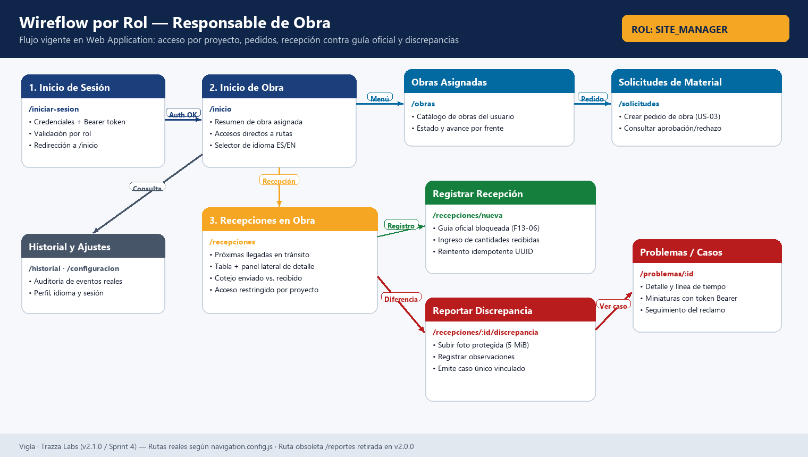
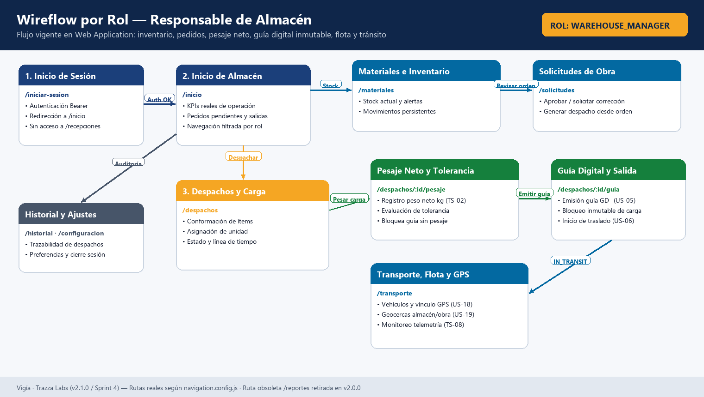
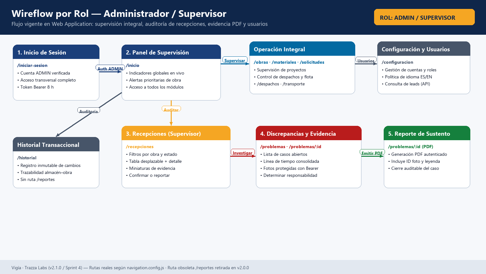

#### 4.4.2. Web Applications Wireflow Diagrams

El wireflow conecta los wireframes de la sección 4.4.1 para mostrar cómo cambia la pantalla ante cada interacción del usuario, de modo que cada nuevo estado se representa con una vista o transición definida. El diagrama parte del inicio de sesión (`/iniciar-sesion`) hacia la pantalla de Inicio (`/inicio`) de cada rol, que funciona como centro de la navegación filtrada por permisos, y de ella salen las rutas vigentes hacia los módulos operativos.

**Actualización de roles y rutas vigentes (v2.0.0 / Sprint 4).** Al evolucionar la Web Application hacia la arquitectura por Bounded Context con control de acceso por rol (`navigation.config.js`), se conservaron los wireflows iniciales elaborados por Elizabeth Noelia Apaza Bocanegra como línea base y se incorporaron los recorridos actualizados por rol, retirando referencias obsoletas a la ruta **Reportes** (eliminada en la versión 2.0.0) y reflejando la separación real de permisos entre **Responsable de Obra (`SITE_MANAGER`)**, **Responsable de Almacén (`WAREHOUSE_MANAGER`)** y **Administrador / Supervisor (`ADMIN`)**:

| Ruta vigente | Módulo | `SITE_MANAGER` | `WAREHOUSE_MANAGER` | `ADMIN` |
|---|---|---|---|---|
| `/inicio` | Inicio / panel del rol | Sí | Sí | Sí |
| `/obras` | Obras asignadas | Sí | No | Sí |
| `/materiales` | Materiales e inventario | No | Sí | Sí |
| `/solicitudes` | Solicitudes de material | Sí | Sí | Sí |
| `/despachos` | Despachos, pesaje y guía digital | No | Sí | Sí |
| `/transporte` | Flota, dispositivos GPS y geocercas | No | Sí | Sí |
| `/recepciones` | Recepción y verificación en obra | Sí | No *(redirige a `/inicio`)* | Sí *(perspectiva Supervisor)* |
| `/problemas` | Casos de discrepancia y evidencia | Sí *(solo proyectos asignados)* | No | Sí *(acceso integral y PDF)* |
| `/historial` | Historial transaccional | Sí | Sí | Sí |
| `/configuracion` | Configuración de cuenta y usuarios | Sí | Sí | Sí |

El wireflow sirve de base para los User Flow Diagrams de la sección 4.4.4, que retoman estas mismas rutas con los Mock-ups finales e incorporan los caminos alternativos.

**Figura 16.** Wireflow Diagram base de la Web Application *(línea base inicial del equipo, aporte de Elizabeth Apaza)*.

**Figura 16a.** Wireflow actualizado por rol — Responsable de Obra (`SITE_MANAGER`): pedidos de obra, recepción con guía oficial bloqueada, cierre conforme atómico y reporte de discrepancia con fotografía protegida. Archivo editable: [wireflow-site-manager.drawio](https://github.com/upc-pre-202620-1asi0730-8084-Developers/vigia-report/blob/develop/assets/Chapther-4/wireflows/wireflow-site-manager.drawio).

**Figura 16b.** Wireflow actualizado por rol — Responsable de Almacén (`WAREHOUSE_MANAGER`): verificación de inventario, aprobación de solicitudes, pesaje neto, emisión de guía de remisión inmutable, inicio de traslado y monitoreo de flota/GPS. Archivo editable: [wireflow-warehouse-manager.drawio](https://github.com/upc-pre-202620-1asi0730-8084-Developers/vigia-report/blob/develop/assets/Chapther-4/wireflows/wireflow-warehouse-manager.drawio).

**Figura 16c.** Wireflow actualizado por rol — Administrador / Supervisor (`ADMIN`): supervisión transversal de operación, auditoría de recepciones, investigación de discrepancias con evidencia protegida y generación del reporte de sustento PDF. Archivo editable: [wireflow-admin-supervisor.drawio](https://github.com/upc-pre-202620-1asi0730-8084-Developers/vigia-report/blob/develop/assets/Chapther-4/wireflows/wireflow-admin-supervisor.drawio).

