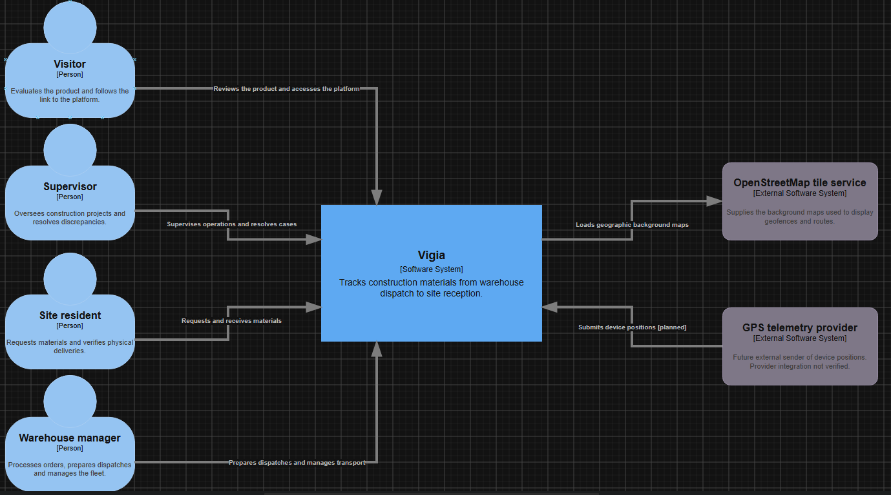

#### 4.6.2. Software Architecture Context Diagram

En esta sección se presenta el Context Level Diagram del C4 Model para Vigía. Este primer nivel de abstracción sitúa a la solución como un único sistema de software y muestra quiénes la utilizan y con qué sistemas de terceros se integra, sin exponer todavía ninguna decisión interna de tecnología ni de estructura. Su propósito es delimitar el alcance del sistema: qué queda dentro de la responsabilidad del equipo y qué queda fuera.

**Sobre la herramienta empleada.** El enunciado del proyecto indica Structurizr para los diagramas de Software Architecture bajo C4 Model. Su servicio en la nube dejó de admitir el registro de cuentas nuevas, por lo que el equipo no pudo emplear esa modalidad. Los diagramas se elaboraron entonces en draw.io, que dispone de la biblioteca oficial de formas del C4 Model y permite compartir el artefacto editable mediante un enlace, que es la condición que el equipo necesitaba conservar.

**Personas.** Los actores que interactúan con el sistema son los mismos identificados en el Design-Level EventStorming de la sección 4.6.1 y en el conjunto de User Stories de la sección 3.1.

| Persona | Organización | Relación con el sistema |
|---|---|---|
| Supervisor | Constructora | Supervisa la operación de las obras y resuelve los casos de discrepancia |
| Encargado de obra | Constructora | Solicita materiales, registra la llegada de la unidad, verifica el material recibido y registra la conformidad o reporta una discrepancia |
| Encargado de almacén | Operador logístico | Verifica existencias, conforma la carga, registra el pesaje, emite la guía de remisión, asigna la unidad y registra la salida |
| Visitante | Externa | Consulta la propuesta de valor en el Landing Page y accede a la plataforma |

El transportista conduce la unidad y participa del dominio, pero no se representa como usuario de la plataforma. El proveedor externo de telemetría GPS figura como una integración prevista, pendiente de verificación.

**Sistemas externos.**

| Sistema externo | Relación con Vigía |
|---|---|
| Servicio de mapas OpenStreetMap | Proporciona los mapas de fondo para visualizar las geocercas y las rutas |
| Proveedor de telemetría GPS | Integración prevista para enviar los reportes de posición del dispositivo instalado en la unidad de transporte; pendiente de verificación |

**Lectura del diagrama.** Tres observaciones se desprenden de este nivel.

En primer lugar, Vigía se representa como un único sistema de software, rodeado por el visitante y los tres roles de operación: Supervisor, Encargado de obra y Encargado de almacén. El Landing Page y las aplicaciones forman parte de ese sistema y se descomponen en el siguiente nivel.

En segundo lugar, el sistema consulta los mapas de fondo de OpenStreetMap. La relación prevista con el proveedor de telemetría GPS entra hacia Vigía para entregar posiciones; el diagrama indica que esta integración aún no se ha verificado.

En tercer lugar, esta versión no representa integraciones de pago ni correo electrónico como implementadas. El contexto se limita a las relaciones mostradas en la nueva versión del C4.

**Figura 57**

*Diagrama de contexto de la arquitectura de software de Vigía*

*Nota.* Elaborado por el equipo de Trazza Labs en draw.io, aplicando el C4 Model de Simon Brown. El sistema se presenta como una sola unidad frente a sus usuarios y sistemas externos. El diagrama editable puede consultarse en: [C4-Model (draw.io)](https://drive.google.com/file/d/1VHbQQeeRSdGzaou-WfJSaSNDTjN6BFZI/view?usp=sharing).
