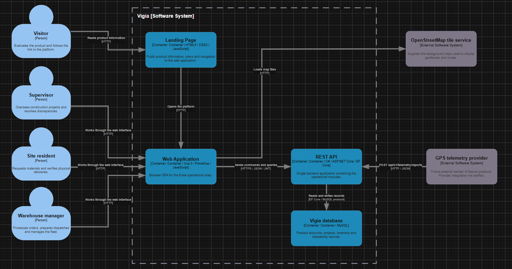
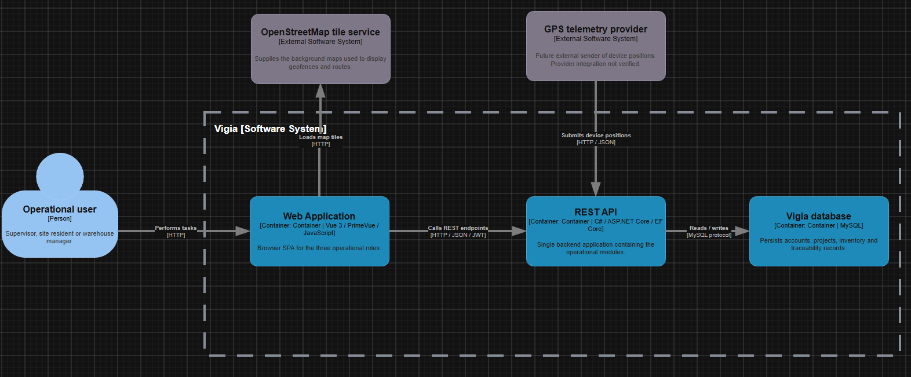

#### 4.6.3. Software Architecture Container Diagrams

En esta sección se presenta el Container Level Diagram del C4 Model para Vigía. Este segundo nivel de abstracción descompone el sistema presentado en la sección 4.6.2 en sus unidades de despliegue independientes, muestra cómo se reparten las responsabilidades entre ellas, expone las principales decisiones de tecnología y describe la forma en que se comunican entre sí. Conforme al C4 Model, cada container representa una unidad que puede desplegarse y ejecutarse por separado.

**Containers de la solución.**

| Container | Tecnología | Responsabilidad |
|---|---|---|
| Landing Page | HTML5, CSS3 y JavaScript | Presenta la propuesta de valor de Vigía y las secciones dirigidas a cada segmento objetivo, y permite acceder a la Web Application |
| Web Application | Vue Framework con PrimeVue como biblioteca de componentes de interfaz | Ofrece la interfaz de trabajo de los tres roles del dominio: pedido, despacho, recepción y gestión de discrepancias |
| RESTful API | ASP.NET Core Framework con Entity Framework Core, lenguaje C# | Concentra los módulos de operación y autenticación, aplica las reglas de los agregados y expone los endpoints para la Web Application |
| Base de datos relacional | MySQL | Almacena de forma persistente el estado de los agregados y el historial de eventos de cada despacho |

Las tecnologías corresponden a las indicadas en la sección de Tecnología del enunciado del proyecto: HTML5, CSS3 y JavaScript para el Landing Page; Vue Framework con PrimeVue para las Frontend Web Applications; ASP.NET Core con Entity Framework Core y C# para los Web Services bajo estilo arquitectónico RESTful API; y MySQL como sistema gestor de base de datos relacional.

**Comunicación entre containers.**

| Origen | Destino | Protocolo y formato | Propósito |
|---|---|---|---|
| Landing Page | Web Application | Enlace web | Abrir la plataforma desde el sitio público |
| Web Application | RESTful API | HTTPS, JSON, JWT | Ejecutar los comandos y consultas del dominio; su integración en producción sigue pendiente |
| RESTful API | Base de datos | Entity Framework Core sobre el protocolo de MySQL | Leer y escribir el estado de los agregados |
| Web Application | Servicio de mapas OpenStreetMap | HTTP(S), teselas de mapas | Mostrar los mapas de fondo de geocercas y rutas |
| Proveedor de telemetría GPS | RESTful API | HTTP(S), JSON | Entregar los reportes de posición del dispositivo a bordo; integración prevista, pendiente de verificación |

**Decisiones de arquitectura y su justificación.**

*Un único container para los Web Services.* Los módulos de la solución se implementan dentro de una misma RESTful API, manteniendo sus responsabilidades internas según se detalla en la sección 4.6.4. La separación en unidades de despliegue distintas por contexto no se adopta porque, para el alcance previsto, introduciría costos de coordinación y de despliegue que no se corresponden con el tamaño del equipo ni con el volumen de operación esperado. La delimitación lógica de los contextos se preserva, de modo que esa separación permanece disponible como evolución posterior.

*El Landing Page como container separado.* Se despliega de forma independiente de la Web Application porque responde a una audiencia distinta, no requiere autenticación y, conforme al Product Backlog de la sección 3.3, se aborda desde el primer sprint sin depender de ninguna otra funcionalidad.

*Integración de telemetría.* El diagrama contempla que un proveedor externo entregue posiciones al endpoint de telemetría del RESTful API. Esta relación representa una integración prevista y no acredita la conexión con un proveedor real.

*Dos vistas del mismo nivel.* La vista general incluye el Landing Page, la Web Application, el RESTful API y MySQL. La vista de operación filtra el Landing Page y su visitante para enfocar la comunicación entre la Web Application, el API y la base de datos; ambas representan el mismo sistema y el mismo nivel de C4.

**Figura 58**

*Diagrama de contenedores de la arquitectura de software de Vigía — vista general*

*Nota.* Elaborado por el equipo de Trazza Labs en draw.io, aplicando el C4 Model de Simon Brown. El recuadro de borde punteado delimita el alcance del sistema. El diagrama editable puede consultarse en: [C4-Model (draw.io)](https://drive.google.com/file/d/1VHbQQeeRSdGzaou-WfJSaSNDTjN6BFZI/view?usp=sharing).

**Figura 58-A**

*Diagrama de contenedores de la arquitectura de software de Vigía — vista de operación*

*Nota.* Elaborado por el equipo de Trazza Labs en draw.io, aplicando el C4 Model de Simon Brown. Esta vista enfoca los contenedores de operación del mismo sistema. El diagrama editable puede consultarse en: [C4-Model (draw.io)](https://drive.google.com/file/d/1VHbQQeeRSdGzaou-WfJSaSNDTjN6BFZI/view?usp=sharing).
