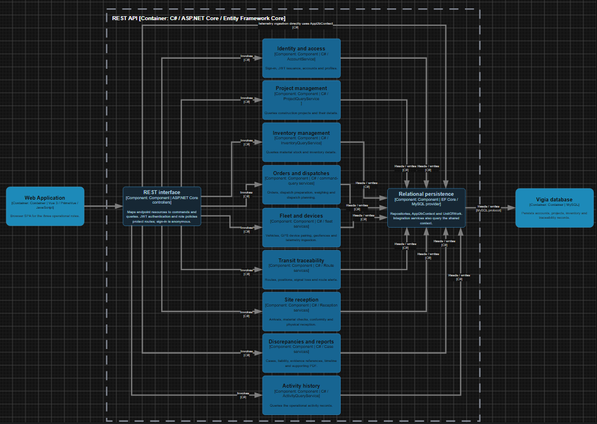
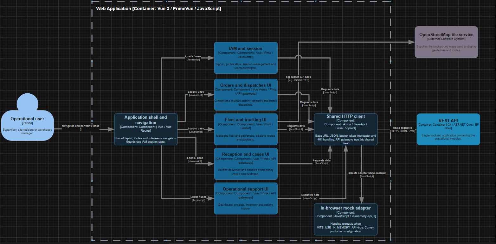

#### 4.6.4. Software Architecture Components Diagrams

En esta sección se presentan los Component Level Diagrams del C4 Model correspondientes a los containers definidos en la sección 4.6.3. Este tercer nivel de abstracción descompone cada container en sus bloques estructurales principales, indicando de qué responde cada uno y con qué tecnología se implementa. Se elaboran diagramas para el RESTful API y la Web Application. El Landing Page se mantiene en el nivel de contenedores y no se descompone aquí. La base de datos relacional se aborda en la sección 4.8.

---

##### Component Diagram — RESTful API

Este container concentra la lógica de dominio de la solución. La nueva versión distingue la interfaz REST, los módulos de servicios y la persistencia relacional dentro de un único proceso del backend. Los componentes se relacionan con los servicios implementados, sin asumir una equivalencia obligatoria entre cada Bounded Context y un componente.

| Componente | Implementación | Responsabilidad |
|---|---|---|
| Identity and access | C# / AccountService | Inicio de sesión, emisión de JWT, cuentas y perfiles |
| Project management | C# / ProjectQueryService | Consulta de obras y sus detalles |
| Inventory management | C# / InventoryQueryService | Consulta de materiales y existencias |
| Orders and dispatches | C# / servicios de comandos y consultas | Pedidos, preparación de despachos, pesaje y planificación de salida |
| Fleet and devices | C# / servicios de flota | Unidades, vinculación GPS, geocercas e ingreso de telemetría |
| Transit traceability | C# / servicios de rutas | Recorridos, posiciones, pérdida de señal y alertas |
| Site reception | C# / servicios de recepción | Llegadas, verificación de materiales, conformidad y recepción física |
| Discrepancies and reports | C# / servicios de casos | Casos, responsabilidad, referencias de evidencia, línea de tiempo y reporte de sustento |
| Activity history | C# / ActivityQueryService | Consulta de registros de actividad operativa |

Además de los módulos de servicios, el container incluye los componentes de interfaz y persistencia:

| Componente | Responsabilidad | Tecnología |
|---|---|---|
| REST interface | Convierte las solicitudes HTTP en comandos y consultas; la autenticación JWT y las políticas de roles protegen las rutas | Controladores de ASP.NET Core |
| Relational persistence | Repositorios, AppDbContext y UnitOfWork para consultar y guardar el estado de los agregados | Entity Framework Core / proveedor MySQL |

**Dos observaciones sobre el diagrama.**

El inicio de sesión admite acceso anónimo; las rutas protegidas aplican autenticación y autorización en el backend. El middleware de autenticación no sustituye a los controladores que reciben las solicitudes.

La recepción de telemetría pertenece al módulo de flota. El diagrama muestra el acceso directo de esa operación a AppDbContext, sin asumir una conexión automática con el módulo de tránsito.

**Interacción entre componentes.** La Web Application invoca la interfaz REST; los controladores delegan en los módulos de servicios y estos consultan o guardan información mediante la persistencia relacional. MySQL se muestra fuera de la frontera del API, como contenedor de datos.

**Figura 59**

*Diagrama de componentes del RESTful API de Vigía*

*Nota.* Elaborado por el equipo de Trazza Labs en draw.io, aplicando el C4 Model de Simon Brown. Los componentes corresponden a la interfaz REST, los módulos de servicios y la persistencia del backend. El diagrama editable puede consultarse en: [C4-Model (draw.io)](https://drive.google.com/file/d/1VHbQQeeRSdGzaou-WfJSaSNDTjN6BFZI/view?usp=sharing).

---

##### Component Diagram — Web Application

Este container concentra la interfaz de trabajo de los tres roles del dominio: Supervisor, Responsable de obra y Responsable de almacén. Su descomposición agrupa las vistas, stores y gateways relacionados, en lugar de representar cada pantalla como un componente arquitectónico independiente.

| Componente | Responsabilidad |
|---|---|
| Application shell and navigation | Layout compartido, rutas y navegación según rol mediante Vue Router |
| IAM and session | Inicio de sesión, perfil, estado de sesión e interceptor del token |
| Orders and dispatches UI | Creación y revisión de pedidos, preparación y seguimiento de despachos |
| Fleet and tracking UI | Flota, geocercas, rutas y visualización de posiciones con Leaflet |
| Reception and cases UI | Verificación de recepciones, casos de discrepancia y evidencia |
| Operational support UI | Inicio, obras, inventario e historial de actividad |

Además de los módulos de interfaz, el container incluye los componentes de acceso a datos:

| Componente | Responsabilidad | Tecnología |
|---|---|---|
| Shared HTTP client | URL base, solicitudes JSON, token Bearer y manejo de respuestas 401 | Axios / BaseApi / BaseEndpoint |
| In-browser mock adapter | Responde localmente cuando se habilita VITE_USE_IN_MEMORY_API; corresponde a la configuración de producción revisada | JavaScript / in-memory-api.js |

**Una observación sobre el diagrama.** Los guards mejoran la navegación según la sesión y el rol, pero no reemplazan la autorización del backend. PrimeVue y vue-i18n son bibliotecas de soporte de los módulos de interfaz, no contenedores independientes.

**Interacción entre componentes.** La navegación habilita los módulos funcionales y estos solicitan datos mediante el cliente HTTP compartido. El cliente puede usar el adaptador en memoria o comunicarse con el RESTful API; la integración real en producción sigue pendiente. El módulo de flota y seguimiento consulta las teselas de OpenStreetMap para los mapas de fondo.

**Figura 60**

*Diagrama de componentes de la Web Application de Vigía*

*Nota.* Elaborado por el equipo de Trazza Labs en draw.io, aplicando el C4 Model de Simon Brown. Los módulos agrupan vistas, estado y acceso a datos relacionados dentro de la misma SPA. El diagrama editable puede consultarse en: [C4-Model (draw.io)](https://drive.google.com/file/d/1VHbQQeeRSdGzaou-WfJSaSNDTjN6BFZI/view?usp=sharing).
