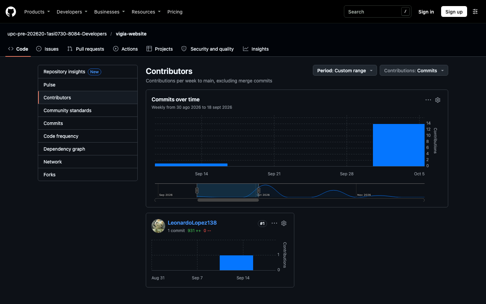

##### 5.2.1.8. Team Collaboration Insights during Sprint

El equipo trabajó bajo GitFlow, con una rama `feature/<nombre>` por integrante sobre el repositorio vigia-report, integrando el trabajo a `develop` mediante Pull Request. Durante el Sprint 1 se fusionaron los Pull Requests #7, #8, #9 y #10 hacia `develop`, evidenciando revisión antes de la integración en lugar de commits directos sobre la rama compartida.

**Participación registrada (commits en vigia-report a la fecha de esta entrega):**

| Integrante (usuario de GitHub) | Commits | Rama de trabajo     |
|---|---|---------------------|
| Leonardo Lopez / Deiko-138 | 39 | `feature/leonardo`  |
| ApazaEN | 27 | `feature/Apaza`     |
| FabianSandovalCueto / JFabianSandoval | 20 | `feature/Sandoval`  |
| eliocerdan | 9 | `feature/Ramos`     |
| Usuario353 | 8 | `feature/Cardenas.` |

Los cinco integrantes registran commits propios durante el Sprint, lo que evidencia participación distribuida en la elaboración del informe. En el repositorio `vigia-website`, el historial de Git registra un único commit del Sprint (`689c72f`, `LeonardoLopez138`), que incorpora la primera versión del Landing Page; las tasks de implementación y sus responsables se detallan en la sección 5.2.1.3.

**Figura 84**

**Figura 85.** Contributors del repositorio vigia-website durante el Sprint 1.

