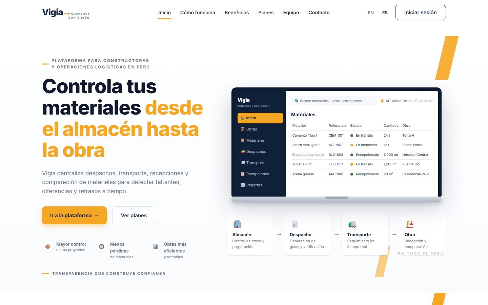
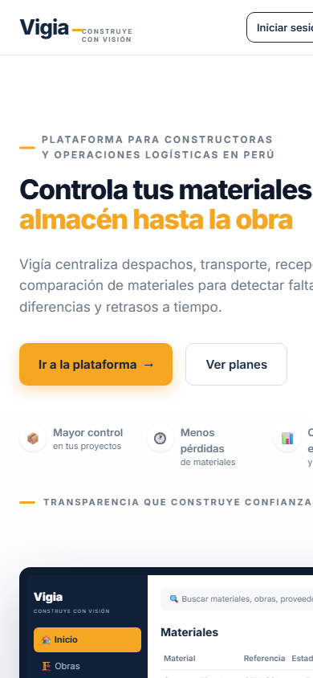
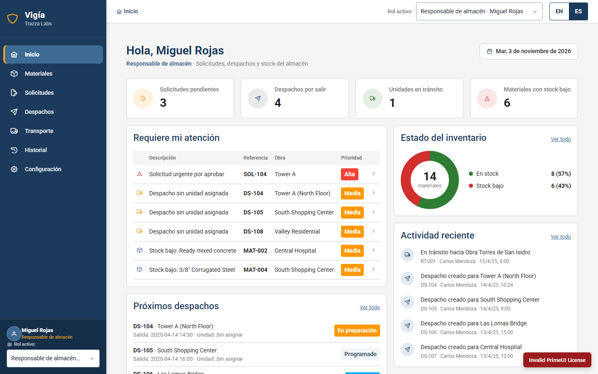

##### 5.2.2.7. Software Deployment Evidence for Sprint Review

Durante el Sprint 2 se desplegaron dos de los tres productos de la solución: la segunda versión del Landing Page y la primera versión de la Frontend Web Application. El tercer producto, los Web Services (RESTful API), aún no se despliega: su repositorio `vigia-platform` contiene únicamente la estructura inicial del proyecto, por lo que la Web Application consume por ahora datos simulados con `json-server` (sección 5.2.2.6).

| Producto | Plataforma | URL pública | Repositorio |
|---|---|---|---|
| Landing Page v2 | GitHub Pages (rama `main`, carpeta `/docs`) | https://upc-pre-202620-1asi0730-8084-developers.github.io/vigia-website/ | `upc-pre-202620-1asi0730-8084-Developers/vigia-website` |
| Frontend Web Application v1 | Firebase Hosting | https://vigia-frontend-8084.web.app | `upc-pre-202620-1asi0730-8084-Developers/vigia-web-application` |
| Web Services (RESTful API) | No desplegado en este Sprint | — | `upc-pre-202620-1asi0730-8084-Developers/vigia-platform` |

**Landing Page v2.** La nueva versión incorpora el selector de idioma inglés/español y los accesos a la Web Application. Los botones *Ir a la plataforma* e *Iniciar sesión* redirigen al usuario a la Frontend Web Application desplegada, de modo que la experiencia sea consistente entre ambos productos, conforme a lo exigido por el enunciado del proyecto.

**Figura 1.** Landing Page v2 en Desktop Web Browser (1440 × 900 px), capturado el 3 de noviembre de 2026.

**Figura 2.** Landing Page v2 en Mobile Web Browser (390 × 844 px), que evidencia la adaptación de la interfaz a las dimensiones del dispositivo.

**Frontend Web Application v1.** La Web Application se publicó en Firebase Hosting; la configuración de publicación se desarrolló en la rama `feature/firebase-hosting` del repositorio `vigia-web-application`. La aplicación se construye con Vite (`npm run build`) y el resultado se sirve como sitio estático.

**Figura 3.** Pantalla de Inicio de la Frontend Web Application v1 desplegada en Firebase Hosting, con el rol *Responsable de almacén*.

