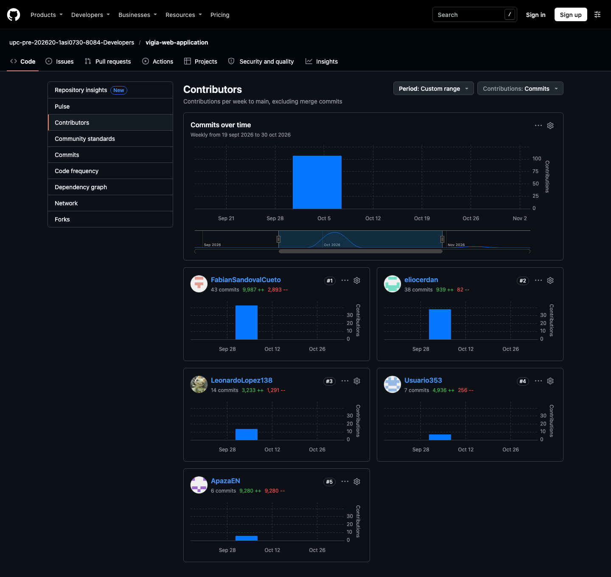
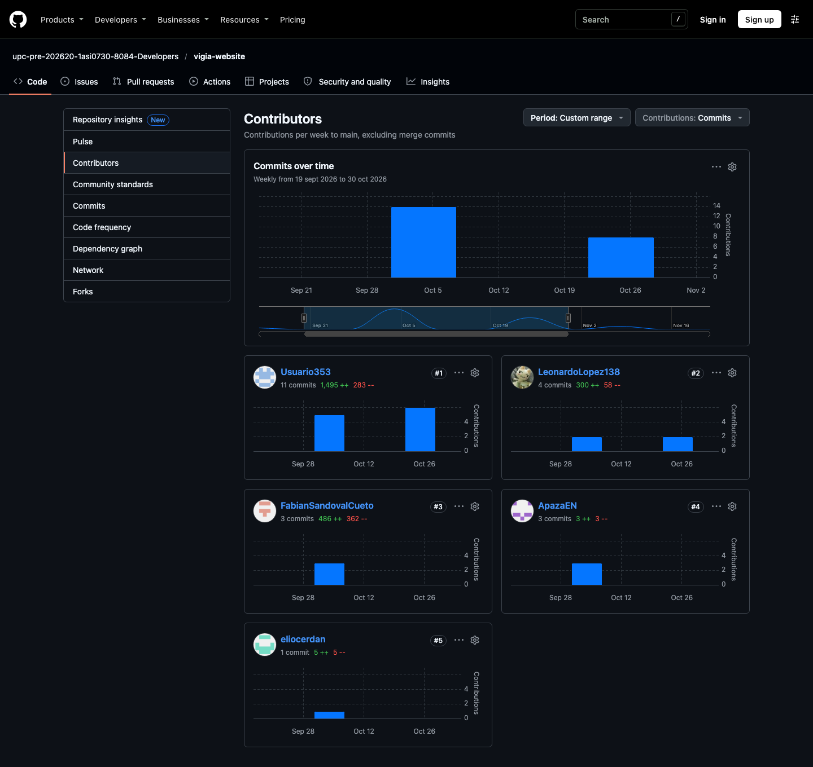

##### 5.2.2.8. Team Collaboration Insights during Sprint

Esta subsección documenta cómo colaboró el equipo durante el Sprint 2 bajo GitFlow. Conforme a lo exigido por el enunciado, todos los integrantes participaron en la implementación de los productos del alcance del Sprint, y a continuación se presentan los analíticos de colaboración y de commits del repositorio en GitHub.

Durante el Sprint 2 el trabajo se organizó por funcionalidades, cada una desarrollada en su propia rama `feature/*` e integrada a la rama `develop` mediante Pull Requests, siguiendo Conventional Commits y Semantic Versioning. En total se integraron **27 ramas de trabajo** a `develop` (13 vía Pull Request formal y 14 por *merge* de rama), lo que evidencia un flujo de integración continuo y distribuido entre los miembros del equipo. Las figuras del final de esta sección presentan los analíticos de colaboración (Insights) y de commits de los repositorios `vigia-web-application` y `vigia-website`.

**Participación por integrante (commits en la rama `develop`).** El siguiente cuadro resume el número de commits aportados por cada miembro, identificado por su usuario de GitHub, sobre un total de 132 commits registrados en la rama `develop` del repositorio de la Frontend Web Application:

| Team Member                   | GitHub Username       | Commits | Principales aportes en el Sprint |
|-------------------------------|-----------------------|---|---|
| Fabián Sandoval (Team Leader) | `FabianSandovalCueto` | 55 | Arquitectura base y componentes compartidos, dashboards por rol, trazabilidad en tránsito, gestión de proyectos/inventario, integración a `develop` y coordinación general |
| Elías Ramos                   | `eliocerdan`          | 48 | Gestión de discrepancias y evidencias (lista, detalle, cierre, responsabilidad, evidencia fotográfica), internacionalización (i18n) |
| Leonardo Lopez                | `LeonardoLopez138`   | 14 | Gestión de órdenes y despachos (`feature/order-management-and-dispatch`) |
| Mathias Cárdenas              | `Usuario353`          | 8 | Recepción y verificación en obra (BC-07) |
| Elizabeth Apaza               | `ApazaEN`             | 7 | Gestión de flota y registro de dispositivos (BC-04) |

La distribución de commits y la cantidad de ramas integradas evidencian que la carga de implementación se repartió entre los integrantes y que todos tuvieron participación efectiva sobre el producto del Sprint. La relación detallada de cada commit (identificador, rama, mensaje y fecha) se encuentra en la sección 5.2.2.4. *Development Evidence for Sprint Review*.

El gráfico *Contributors* de GitHub cuenta los commits integrados en `main`, sin fusiones, por lo que sus cifras difieren de las del cuadro anterior. En `vigia-website`, los cinco integrantes registran commits durante el Sprint 2.

**Figura 1.** Analíticos de commits de la Frontend Web Application.

**Figura 2.** Contributors de vigia-web-application durante el Sprint 2.

**Figura 3.** Contributors de vigia-website durante el Sprint 2.

