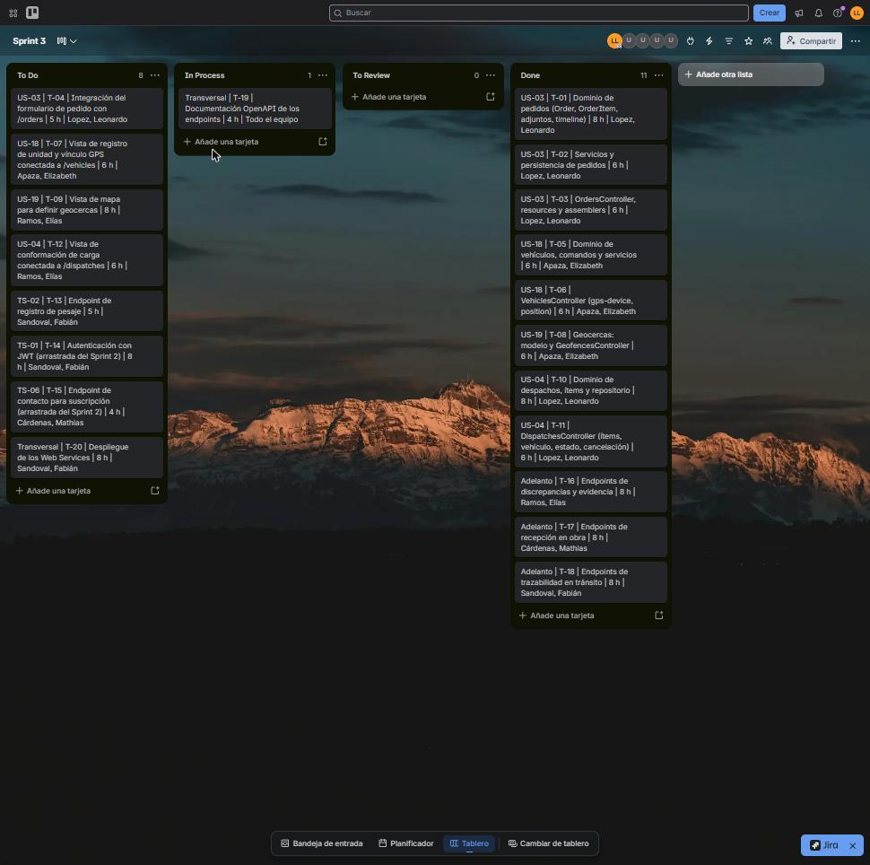

##### 5.2.3.3. Sprint Backlog 3

El objetivo del Sprint 3 es publicar la primera versión de los Web Services y conectar la Web Application con datos reales de pedidos, flota, geocercas y despachos. El alcance corresponde a las historias US-03, US-18, US-19, US-04 y TS-02 del Product Backlog (19 Story Points), más las Technical Stories TS-01 y TS-06 arrastradas del Sprint 2 (5 Story Points). El seguimiento de las tasks se realiza en un tablero de Trello con los estados To Do, In Process, To Review y Done.

**Pendiente:** cambiar la visibilidad del tablero a público, para que el URL del board sea accesible sin iniciar sesión: https://trello.com/b/E1hJwxUN/sprint-3

**Figura 1.** Board del Sprint 3 en Trello.

**User Stories del Sprint 3**

| Story Id | Story Title | Story Points |
|---|---|---|
| US-03 | Envío de pedido de materiales | 3 |
| US-18 | Registro de unidad de transporte y vinculación de dispositivo GPS | 5 |
| US-19 | Definición de geocercas de almacén y obra | 3 |
| US-04 | Conformación de carga y registro de pesaje | 5 |
| TS-02 | Endpoint de registro de pesaje | 3 |
| TS-01 | Endpoint de autenticación de usuarios (arrastrada del Sprint 2) | 3 |
| TS-06 | Endpoint de contacto para suscripción (arrastrada del Sprint 2) | 2 |

**Work-Items / Tasks.** Cada User Story se descompone en Engineering Tasks de 4 a 8 horas como máximo. El estado refleja lo registrado en el repositorio `vigia-platform` a la fecha de redacción.

| Story Id | Task Id | Task Title | Task Description | Estimation (Hours) | Assigned To | Status |
|---|---|---|---|---|---|---|
| US-03 | T-01 | Dominio de pedidos | Agregados `Order`, `OrderItem`, `OrderAttachedFile` y `OrderTimelineEvent`, con sus comandos y consultas. | 8 | Lopez, Leonardo | Done |
| US-03 | T-02 | Servicios y persistencia de pedidos | Servicios de comando y consulta y repositorio con Entity Framework Core. | 6 | Lopez, Leonardo | Done |
| US-03 | T-03 | `OrdersController` | Endpoints REST de pedidos (listar, consultar, crear, adjuntar archivos y cambiar estado), con resources y assemblers. | 6 | Lopez, Leonardo | Done |
| US-03 | T-04 | Integración del formulario de pedido | Conectar el formulario de pedido de la Web App con `/api/v1/orders`. | 5 | Lopez, Leonardo | To Do |
| US-18 | T-05 | Dominio de vehículos | Agregado `Vehicle`, comandos y servicios de registro y vinculación de dispositivo GPS. | 6 | Apaza Bocanegra, Elizabeth | Done |
| US-18 | T-06 | `VehiclesController` | Repositorios EF Core y endpoints de vehículos, vinculación `gps-device` y actualización de posición. | 6 | Apaza Bocanegra, Elizabeth | Done |
| US-18 | T-07 | Vista de registro de unidad y vínculo GPS | Conectar la pantalla de Transporte y Flota con `/api/v1/vehicles`. | 6 | Apaza Bocanegra, Elizabeth | To Do |
| US-19 | T-08 | Geocercas | Modelo `Geofence` y `GeofencesController` para definir y consultar geocercas. | 6 | Apaza Bocanegra, Elizabeth | Done |
| US-19 | T-09 | Vista de mapa para geocercas | Vista con mapa para dibujar el perímetro del predio y confirmar la geocerca. | 8 | Ramos Cerdán, Elías | To Do |
| US-04 | T-10 | Dominio de despachos | Agregado `Dispatch` con ítems, servicios de comando y consulta y repositorio EF Core. | 8 | Lopez, Leonardo | Done |
| US-04 | T-11 | `DispatchesController` | Endpoints de despachos: ítems, asignación de vehículo, cambio de estado y cancelación. | 6 | Lopez, Leonardo | Done |
| US-04 | T-12 | Vista de conformación de carga | Conectar la pantalla de Despachos con `/api/v1/dispatches`. | 6 | Ramos Cerdán, Elías | To Do |
| TS-02 | T-13 | Endpoint de registro de pesaje | `POST /api/v1/dispatches/{dispatchId}/weighing`: recibe el peso en kilogramos y lo registra en el despacho con su evento en la línea de tiempo. | 5 | Sandoval Cueto, Fabián | To Review (implementado, pendiente de Pull Request) |
| TS-01 | T-14 | Autenticación | `POST /api/v1/authentication/sign-in`: valida las credenciales contra el hash almacenado y emite un JWT con el usuario y el rol. | 8 | Sandoval Cueto, Fabián | To Review (implementado, pendiente de Pull Request) |
| TS-06 | T-15 | Endpoint de contacto | `POST /api/v1/contact-requests`: recibe y valida los datos del formulario de contacto del Landing Page. | 4 | Cárdenas Huaman, Mathias | To Review (implementado, pendiente de Pull Request) |
| Adelanto | T-16 | Discrepancias y evidencia | Endpoints de casos de discrepancia: crear, consultar, línea de tiempo y determinar responsabilidad o cerrar. | 8 | Ramos Cerdán, Elías | Done |
| Adelanto | T-17 | Recepción en obra | Endpoints de recepciones: arribos, confirmación, verificación de material, conformidad, discrepancia y evidencia. | 8 | Cárdenas Huaman, Mathias | Done (rama `feature/site-reception-and-verification`) |
| Adelanto | T-18 | Trazabilidad en tránsito | Endpoints de rutas: posiciones, pérdida de señal y alertas de desvío. | 8 | Sandoval Cueto, Fabián | Done |
| Transversal | T-19 | Documentación OpenAPI | Documentar los endpoints de cada Bounded Context con OpenAPI. | 4 | Todo el equipo | In Process |
| Transversal | T-20 | Despliegue de los Web Services | Desplegar la primera versión del RESTful API con su base de datos y variables de entorno. | 8 | Sandoval Cueto, Fabián | To Do |

**Total de horas estimadas:** 130 h. Completadas (Done): 76 h. En revisión (To Review): 17 h. Pendientes: 37 h.  *Actualizar el estado de cada task al cierre del Sprint.*

Las filas marcadas como *Adelanto* corresponden a endpoints que el Product Backlog asigna a Sprints posteriores y que el equipo adelantó para integrarlos con las pantallas ya existentes de la Web Application.
