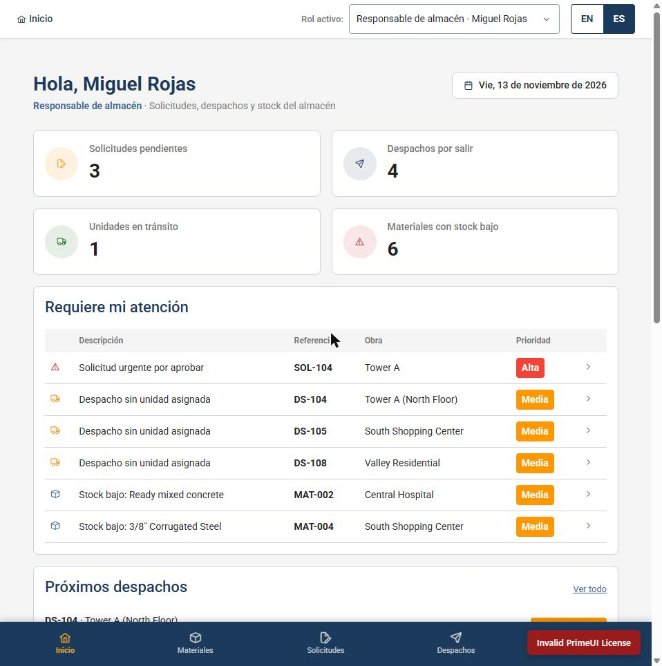
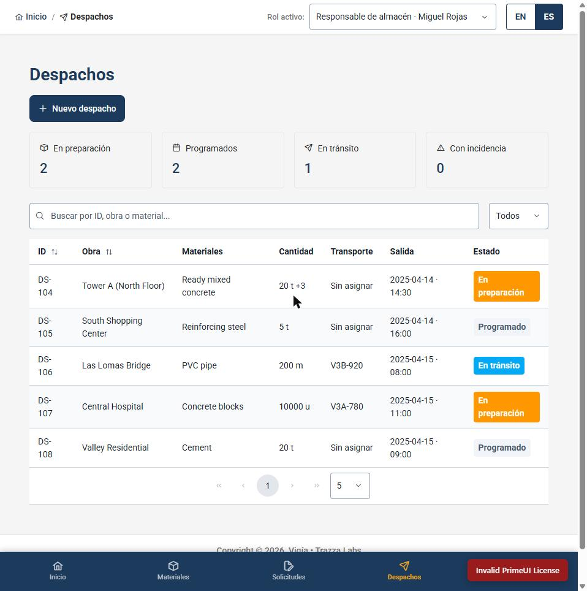
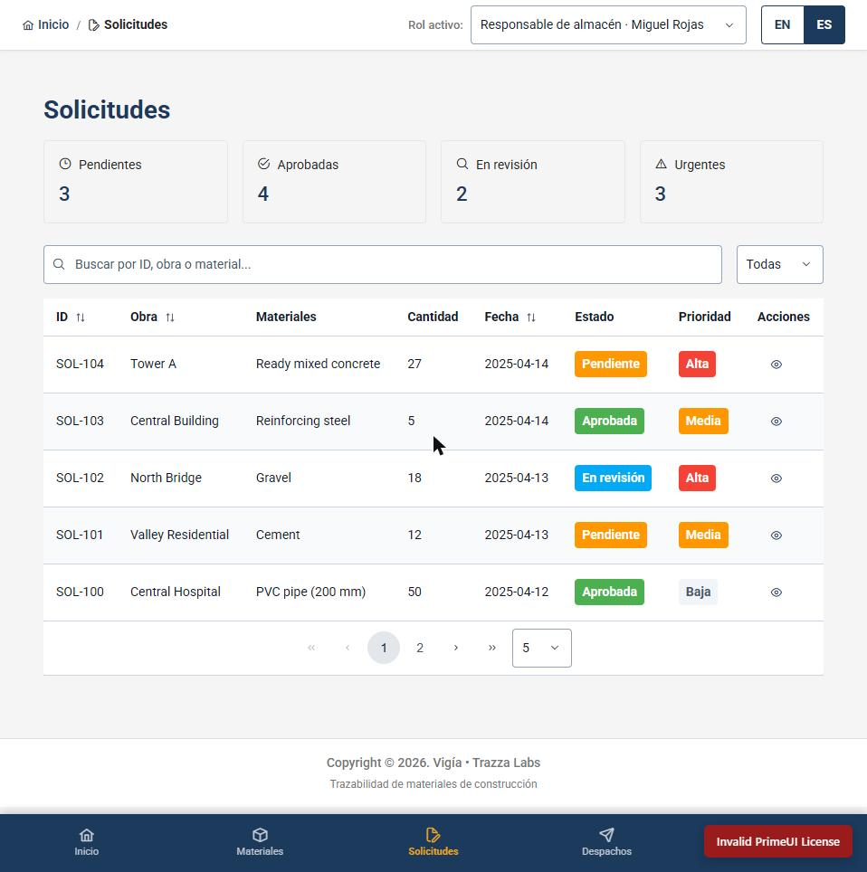
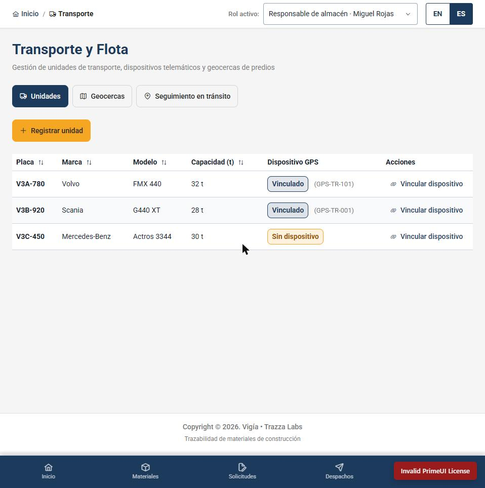

##### 5.2.3.5. Execution Evidence for Sprint Review

En el Sprint 3 la ejecución del producto se evidencia en dos frentes: la Web Application, cuyas vistas por rol se capturaron en el Sprint 2 y se mantienen como base de la integración, y los Web Services, cuyos endpoints se ejecutan y se prueban a través de la documentación OpenAPI interactiva (sección 5.2.3.6) y de los archivos de requests HTTP del repositorio `vigia-platform`.

**Vistas de la Web Application.** La Web Application v1 presenta, para los roles Supervisor, Responsable de Almacén y Responsable de Obra, las pantallas de Inicio, Solicitudes, Despachos, Transporte y Flota, Materiales, Recepciones, Problemas, Historial, Obras y Configuración. Las capturas de cada vista se encuentran en la sección 5.2.2.5. En este Sprint las pantallas de Solicitudes, Despachos, Transporte y Flota y Problemas son las que deben conectarse a los endpoints `/orders`, `/dispatches`, `/vehicles`, `/geofences` y `/discrepancy-cases` del nuevo API, reemplazando el servidor simulado `json-server` (tasks T-04, T-07, T-09 y T-12 del Sprint Backlog 3).

**Ejecución de los Web Services.** Cada endpoint se prueba con el documento OpenAPI generado por el API y con los archivos de requests HTTP incluidos en el repositorio (por ejemplo, el de Transit Traceability, commit `7cefe82`). Los casos que se prueban de esta forma incluyen la creación de un pedido, el registro de un vehículo con su dispositivo GPS, la definición de una geocerca, la creación de un despacho con ítems y la asignación de su vehículo, y la apertura, consulta y cierre de un caso de discrepancia con su línea de tiempo.

**Web Application v2.0.0.** En el Sprint 3 se publicó la versión 2.0.0 de la Web Application, con la interfaz alineada al mock-up v2 (layout, barra lateral, variables de tema y etiquetas de recepción) y sin la ruta de Reportes que no tenía funcionalidad. Las siguientes capturas corresponden a la versión desplegada en https://vigia-frontend-8084.web.app con el rol *Responsable de almacén*, el 13 de noviembre de 2026.

**Figura 1.** Pantalla de Inicio del Responsable de almacén: indicadores de solicitudes pendientes, despachos por salir, unidades en tránsito y materiales con stock bajo, y la sección "Requiere mi atención" con las prioridades.

**Figura 2.** Módulo Despachos: contadores por estado (en preparación, programados, en tránsito, con incidencia), búsqueda y listado de despachos con obra, materiales, cantidad, transporte y estado.

**Figura 3.** Módulo Solicitudes: indicadores de solicitudes pendientes, aprobadas, en revisión y urgentes, con filtros, estado y prioridad por solicitud.

**Figura 4.** Módulo Transporte y Flota: unidades con placa, marca, modelo, capacidad y estado del dispositivo GPS (vinculado o sin dispositivo), con las pestañas de Geocercas y Seguimiento en tránsito.

🟢 **Pendiente:** agregar (1) capturas de las vistas ya integradas con el API, cuando la Web Application deje de usar datos simulados, (2) capturas de la ejecución de los endpoints en la documentación interactiva y (3) el enlace al video que muestra la navegación y la ejecución, publicado en Microsoft Stream.
