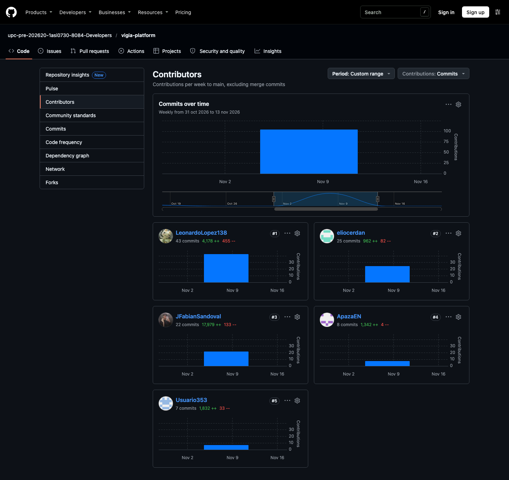
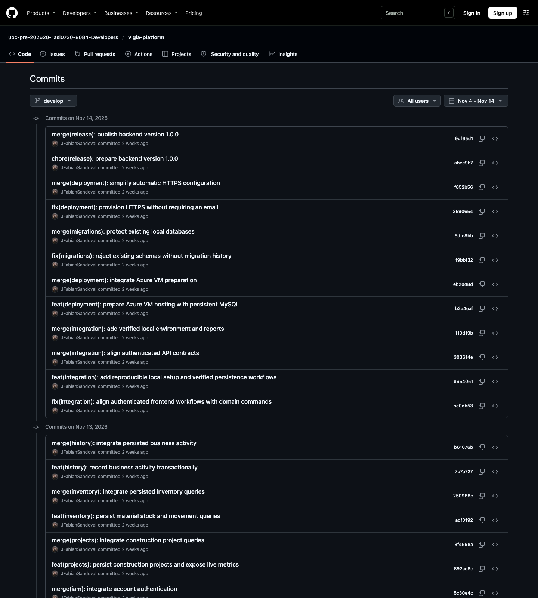
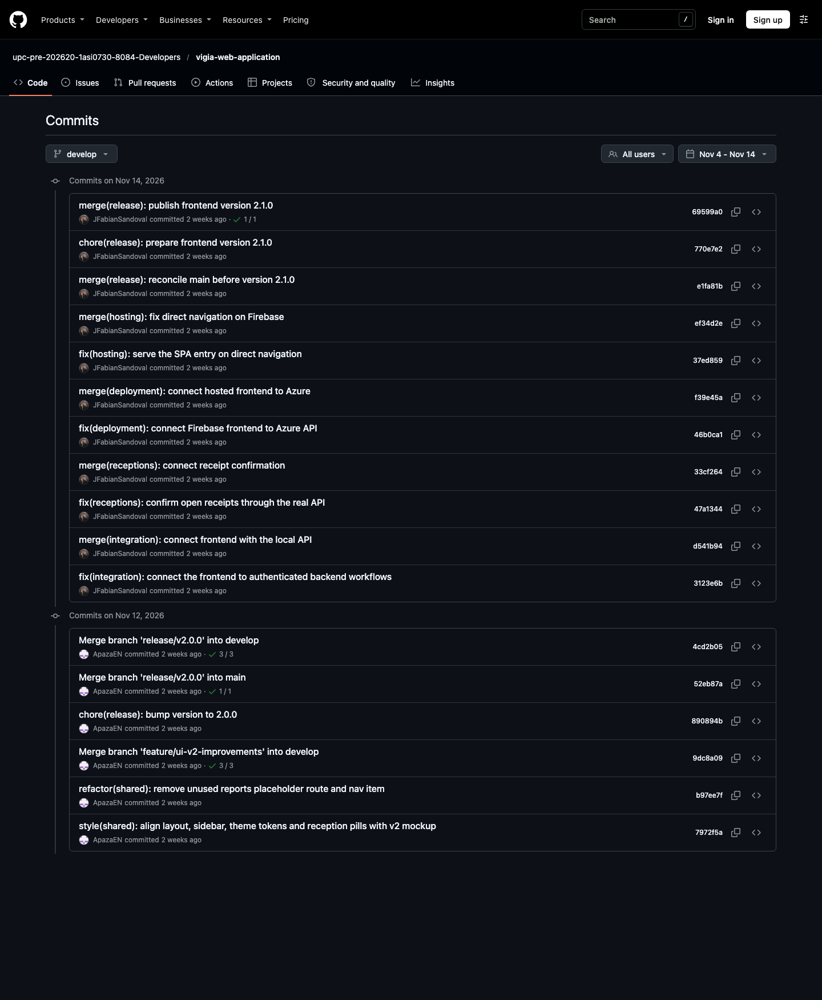
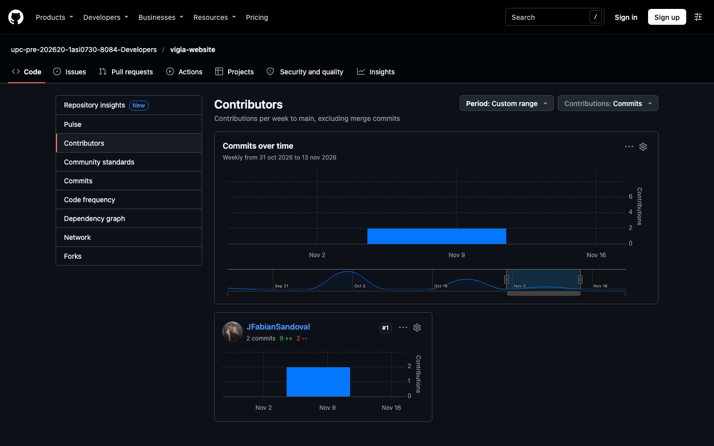

##### 5.2.3.8. Team Collaboration Insights during Sprint

Esta subsección documenta cómo colaboró el equipo durante el Sprint 3. El trabajo del RESTful API se organizó por Bounded Context, con una rama `feature/*` por contexto (`feature/Order-management-and-dispatch`, `feature/fleet-and-device-registry`, `feature/discrepancy-and-evidence-management`, `feature/site-reception-and-verification` y `feature/transit-traceability`), integradas a `develop` mediante Pull Requests bajo GitFlow y Conventional Commits. Los cinco integrantes tienen commits propios en el repositorio de Web Services.

**Participación por integrante en `vigia-platform` (commits propios del Sprint 3, sin fusiones ni duplicados).**

| Team Member | GitHub Username | Commits | Principales aportes en el Sprint |
|---|---|---|---|
| Lopez, Leonardo | `LeonardoLopez138` | 43 | Bounded Context Order Management & Dispatch: agregados, servicios, repositorios y controladores de pedidos y despachos; ajustes del núcleo compartido |
| Ramos Cerdán, Elías | `eliocerdan` | 25 | Bounded Context Discrepancy & Evidence Management: creación, consulta, línea de tiempo, responsabilidad y cierre de casos |
| Sandoval Cueto, Fabián | `JFabianSandoval` | 22 | Bounded Context Transit Traceability: ruta, desvíos, alertas y controlador; migración inicial de la base de datos; autenticación, proyectos, inventario e historial; despliegue en Azure, versión 1.0.0 e integración de ramas a `develop` |
| Apaza Bocanegra, Elizabeth | `ApazaEN` | 8 | Bounded Context Fleet & Device Registry: vehículos, dispositivos GPS, geocercas y documentación OpenAPI |
| Cárdenas Huaman, Mathias | `Usuario353` | 7 | Bounded Context Site Reception & Verification: recepciones, repositorio y datos de prueba |

Los cuadros de commits corresponden a los 105 commits únicos del Sprint 3 detallados en la sección 5.2.3.4. La distribución muestra que cada integrante lideró un Bounded Context, aunque la carga fue desigual, por lo que en el siguiente Sprint conviene repartir con mayor equilibrio las tasks de integración con el frontend.
 
**Participación en `vigia-web-application` y `vigia-website` (commits propios del Sprint 3, sin fusiones).**

| Team Member | GitHub Username | `vigia-web-application` | `vigia-website` |
|---|---|---|---|
| Sandoval Cueto, Fabián | `JFabianSandoval` | 5 | 2 |
| Apaza Bocanegra, Elizabeth | `ApazaEN` | 3 | 0 |
| Lopez, Leonardo | `LeonardoLopez138` | 0 | 0 |
| Ramos Cerdán, Elías | `eliocerdan` | 0 | 0 |
| Cárdenas Huaman, Mathias | `Usuario353` | 0 | 0 |

**Figura 1.** Contributors de vigia-platform durante el Sprint 3.

**Figura 2.** Fragmento del historial de commits de vigia-platform (rama develop).

**Figura 3.** Historial de commits de vigia-web-application (rama develop).

**Figura 4.** Contributors de vigia-website durante el Sprint 3.

