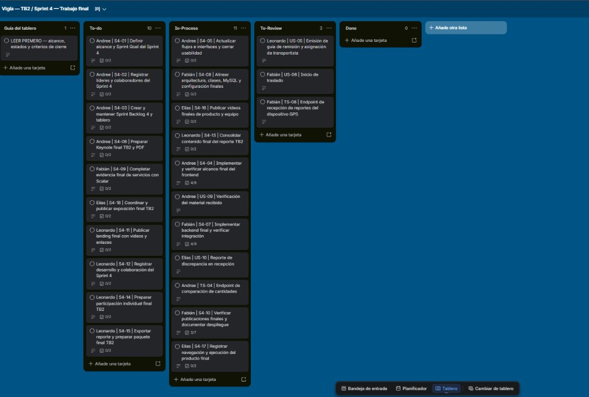

##### 5.2.4.3. Sprint Backlog 4

El objetivo del Sprint 4 es cerrar e integrar el flujo operativo completo de Vigía —desde el pedido, el pesaje y la emisión de guía de remisión hasta el traslado con telemetría GPS, la verificación de recepción en obra, la comparación de cantidades y el reporte de discrepancia con evidencia fotográfica persistente— y publicar las versiones finales de los tres productos para la entrega TB2. El alcance abarca las seis historias asignadas al Sprint 4 en el Product Backlog (`US-05`, `TS-08`, `US-06`, `US-09`, `US-10` y `TS-04`, 21 Story Points), el cierre de las historias técnicas arrastradas de AV2 (`TS-02` y `TS-06`, 5 Story Points) y las 18 tareas de coordinación, implementación, evidencia y entrega final (`S4-01` a `S4-18`).

El seguimiento se gestiona en un tablero público de Trello con cuatro columnas acordadas por el equipo: **To-do** (no iniciado o pendiente), **In-Process** (resuelto parcialmente o en curso), **To-Review** (implementado/redactado y a la espera de revisión o integración) y **Done** (completado para el alcance descrito y con evidencia verificada).

**URL público del tablero del Sprint 4 en Trello:** [https://trello.com/b/Ox4oCNN2/vigia-tb2-sprint-4-trabajo-final](https://trello.com/b/Ox4oCNN2/vigia-tb2-sprint-4-trabajo-final)

**Figura 2.** Board del Sprint 4 (TB2 — Trabajo final) en Trello *(captura de seguimiento; actualizar con el estado definitivo al cierre del Sprint)*.

**Historias comprometidas del Sprint 4**

| Story Id | Story Title | Story Points | Responsable de seguimiento | Estado al 2026-11-26 |
|---|---|---|---|---|
| US-05 | Emisión de guía de remisión y asignación de transportista | 3 | Lopez, Leonardo | To-Review |
| TS-08 | Endpoint de recepción de reportes del dispositivo GPS | 5 | Sandoval Cueto, Fabián | To-Review |
| US-06 | Inicio de traslado | 2 | Sandoval Cueto, Fabián | To-Review |
| US-09 | Verificación del material recibido | 5 | Cárdenas Huaman, Mathias Andree | Done |
| US-10 | Reporte de discrepancia en recepción | 3 | Ramos Cerdán, Elías | In-Process |
| TS-04 | Endpoint de comparación de cantidades | 3 | Cárdenas Huaman, Mathias Andree | Done |
| TS-02 | Endpoint de registro de pesaje *(arrastrada del Sprint 3)* | 3 | Lopez, Leonardo | To-Review |
| TS-06 | Endpoint de contacto para suscripción *(arrastrada del Sprint 2/3)* | 2 | Cárdenas Huaman, Mathias Andree / Lopez, Leonardo | To-Review |

**Work-Items / Tasks del Sprint 4.** Cada historia se descompone en Engineering Tasks de entre 4 y 8 horas como máximo, y se listan además las tareas de planificación, documentación, evidencias, videos y cierre TB2 registradas en Trello (`S4-01` a `S4-18`). Para evitar duplicar esfuerzo, las tarjetas resumen de implementación del tablero (`S4-04` Frontend, `S4-07` Backend/Integración y `S4-11` Landing) se desglosan directamente en sus Engineering Tasks correspondientes (`T-13`, `T-15`, `T-24` a `T-31`) y no se suman dos veces. Las estimaciones en horas constituyen **propuestas de planificación a confirmar con el Team Leader** y no equivalen a horas reales ejecutadas.

| Story Id | Story Title | Task Id | Task Title | Task Description | Estimation (Hours) | Assigned To | Status |
|---|---|---|---|---|---|---|---|
| US-05 | Emisión de guía de remisión y asignación de transportista | T-24 | Guía de remisión digital inmutable y flujo de Despachos | Implementar `POST`/`GET /api/v1/dispatches/{dispatchId}/delivery-guide` con bloqueo sin pesaje vigente, instantánea inmutable de carga/vehículo, idempotencia y vista de autorización de guía en `vigia-web-application` *(cubre bloque de guía de `S4-04`/`S4-07`)*. | 6 | Lopez, Leonardo | To-Review |
| US-06 | Inicio de traslado | T-25 | Confirmación de salida y enlace con ruta activa | Vincular la autorización de guía con el paso a `IN_TRANSIT`, la reserva activa de la unidad de transporte y la confirmación de salida en `vigia-platform` y `vigia-web-application` *(cubre bloque de salida de `S4-04`/`S4-07`)*. | 5 | Sandoval Cueto, Fabián | To-Review |
| TS-08 | Endpoint de recepción de reportes del dispositivo GPS | T-26 | Telemetría GPS ordenada, geocercas e invariantes de flota | Corregir validaciones de vehículos/GPS/geocercas, asegurar orden temporal y persistencia de eventos asociados y no asociados en `TelemetryController` (migraciones EF Core) y exponer el monitoreo en la Web Application *(cubre bloque de flota y telemetría de `S4-04`/`S4-07`)*. | 8 | Sandoval Cueto, Fabián | To-Review |
| US-09 | Verificación del material recibido | T-27 | Autorización por proyecto, guía oficial y cierre atómico de recepción | Exigir pertenencia al proyecto asignado y guía emitida por el servidor, añadir migración de idempotencia y concurrencia (`Version`, `RegisterRequestId`, `VerifyRequestId`), cerrar atómicamente recepción/despacho/ruta en `vigia-platform` y bloquear campos autoritativos en las vistas de recepción de `vigia-web-application` *(entregables A01/A02; integra `S4-04`)*. | 8 | Cárdenas Huaman, Mathias Andree | Done |
| TS-04 | Endpoint de comparación de cantidades | T-28 | Comparación de cantidades y verificación idempotente | Consolidar el cálculo comparativo entre cantidades despachadas y recibidas por ítem y la recuperación idempotente mediante `requestId` entre el RESTful API y el cliente web *(entregables A01/A02; integra `S4-04`)*. | 5 | Cárdenas Huaman, Mathias Andree | Done |
| US-10 | Reporte de discrepancia en recepción | T-29 | Fotografías protegidas de evidencia y casos de discrepancia | Persistir archivos reales de evidencia fotográfica, aplicar autorización por proyecto en casos, línea de tiempo, fotografías y reporte PDF, e integrar la vista de reporte de discrepancias y miniaturas protegidas en `vigia-web-application` *(entregable A03 y cierre de evidencia)* . | 8 | Ramos Cerdán, Elías / Cárdenas Huaman, Mathias Andree | In-Process |
| TS-02 | Endpoint de registro de pesaje *(arrastre AV2)* | T-13 | Pesaje neto, tolerancia e historial persistente | Completar `POST /api/v1/dispatches/{dispatchId}/weighing` con persistencia de peso neto, evaluación de tolerancia, actualización de estado y vista conectada en Despachos *(arrastrada del Sprint 3)*. | 5 | Lopez, Leonardo | To-Review |
| TS-06 | Endpoint de contacto para suscripción *(arrastre AV2)* | T-15 | Endpoint y formulario de contacto del Landing Page | Acordar contrato con el equipo, implementar `POST /api/v1/contact-requests` en `vigia-platform` y conectarlo desde la sección de contacto de `vigia-website` sin alterar el flujo de pesaje *(arrastrada del Sprint 2/3; entregable A04)*. | 4 | Cárdenas Huaman, Mathias Andree / Lopez, Leonardo | To-Review |
| Transversal | Integración transversal, regresión por roles y accesibilidad base *(S4-04 / S4-07)* | T-30 | Regresión por roles, Scalar con Bearer auth e i18n/accesibilidad | Ejecutar pruebas de integración y matriz de permisos por rol (`ADMIN`, `WAREHOUSE_MANAGER`, `SITE_MANAGER`), exponer autenticación Bearer en Scalar, corregir desbordamiento de tablas en recepción y aplicar mejoras base de idioma inglés/teclado. | 8 | Sandoval Cueto, Fabián / Ramos Cerdán, Elías | In-Process |
| Transversal | Publicación final del Landing Page *(S4-11)* | T-31 | Actualización y publicación final del Landing Page | Incorporar videos finales (*About-the-Product* y *About-the-Team*), verificar enlaces, conectar el contacto (`T-15`) y publicar la versión final en GitHub Pages *(desglose de la tarjeta `S4-11`)*. | 4 | Lopez, Leonardo | To-do |
| Planificación | Gestión del Sprint 4 | S4-01 | Definir alcance y Sprint Goal del Sprint 4 | Acordar alcance final, reconciliar los Sprints 5 y 6 frente al cierre TB2, incorporar pendientes vigentes de AV2 y redactar la sección 5.2.4.1. | 2 | Cárdenas Huaman, Mathias Andree | To-Review |
| Planificación | Gestión del Sprint 4 | S4-02 | Registrar líderes y colaboradores del Sprint 4 | Completar la matriz LACX de la sección 5.2.4.2 reflejando a los cuatro integrantes activos, el doble contexto de Fabián Sandoval, el trabajo independiente de Mathias Andree Cárdenas y los créditos históricos de Elizabeth Apaza. | 1 | Cárdenas Huaman, Mathias Andree | To-Review |
| Planificación | Gestión del Sprint 4 | S4-03 | Crear y mantener Sprint Backlog 4 y tablero | Redactar la tabla de seguimiento de la sección 5.2.4.3 enlazada al tablero público de Trello TB2 y mantener actualizados los estados hasta el cierre. | 2 | Cárdenas Huaman, Mathias Andree | To-Review |
| Diseño y UX | Actualización de flujos y usabilidad | S4-05 | Actualizar flujos e interfaces y cerrar usabilidad | Actualizar wireflows por rol sin la ruta obsoleta de Reportes, completar la validación y auditoría de usabilidad/accesibilidad en recepción y Landing Page *(entregables A05 y A12)*. | 3 | Cárdenas Huaman, Mathias Andree | In-Process |
| Sustentación | Presentación final TB2 | S4-06 | Preparar Keynote final TB2 y PDF | Elaborar la presentación final del proyecto en PPTX y PDF priorizando la entrega TB2, con diapositiva de integrantes y demostración *(entregable A10)*. | 4 | Cárdenas Huaman, Mathias Andree | To-Review |
| Arquitectura | Alineamiento documental técnico | S4-08 | Alinear arquitectura, clases, MySQL y configuración finales | Actualizar diagramas C4, clases, base de datos MySQL y configuración de la sección 5.1 para reflejar la versión final de los repositorios. | 4 | Sandoval Cueto, Fabián | In-Process |
| Evidencia API | Documentación de servicios | S4-09 | Completar evidencia final de servicios con Scalar | Registrar la tabla de endpoints OpenAPI/Scalar del Sprint 4 y capturas verificadas de interacción con datos reales y autenticación Bearer *(con aportes de recepción de A11)*. | 3 | Sandoval Cueto, Fabián | To-Review |
| Despliegue | Publicación y verificación en nube | S4-10 | Verificar publicaciones finales y documentar despliegue | Aprobar versiones, verificar respaldo/migración MySQL, desplegar API en Azure y frontend en Firebase Hosting, y registrar evidencia en URLs públicas. | 3 | Sandoval Cueto, Fabián | In-Process |
| Evidencia | Desarrollo y colaboración | S4-12 | Registrar desarrollo y colaboración del Sprint 4 | Documentar la tabla de commits, ramas y analíticos de colaboración (Insights) del Sprint 4 en los tres repositorios *(con evidencia de recepción de A11)*. | 3 | Lopez, Leonardo | To-Review |
| Informe | Consolidación documental TB2 | S4-13 | Consolidar contenido final del reporte TB2 | Integrar secciones terminadas, actualizar Student Outcome, Collaboration Insights, Registro de Versiones, conclusiones de validación (`A09`), bibliografía APA y anexos, regenerando `capitulos-completo.md`. | 4 | Lopez, Leonardo | In-Process |
| Entrega | Evaluación individual | S4-14 | Preparar participación individual final TB2 | Elaborar el *Participant Performance Report* final del equipo en formato Word con la evaluación de cada integrante para TB2. | 2 | Lopez, Leonardo | To-do |
| Entrega | Paquete de entrega TB2 | S4-15 | Exportar reporte y preparar paquete final TB2 | Exportar el PDF definitivo verificando enlaces clicables, incorporar el enlace de exposición y empaquetar el archivo `.zip` final de TB2. | 2 | Lopez, Leonardo | To-do |
| Videos | Videos promocional y de equipo | S4-16 | Publicar videos finales de producto y equipo | Grabar, editar y publicar en Microsoft Stream y YouTube las versiones finales de *Video About-the-Product* y *Video About-the-Team* con sus capturas, enlaces y tiempos. | 4 | Ramos Cerdán, Elías | In-Process |
| Evidencia | Navegación y ejecución | S4-17 | Registrar navegación y ejecución del producto final | Documentar capturas finales y video demostrativo de navegación y ejecución del producto integrado para la sección 5.2.4.5 *(con capturas de recepción de A11)*. | 3 | Ramos Cerdán, Elías | In-Process |
| Sustentación | Exposición final TB2 | S4-18 | Coordinar y publicar exposición final TB2 | Coordinar ensayo, grabación y publicación del video de exposición final de 12 minutos cubriendo demostración en operación y evidencias de colaboración. | 4 | Ramos Cerdán, Elías | To-do |

**Resumen de horas estimadas (propuesta a validar con Fabián Sandoval, corte al 2026-11-26):** 105 h totales (61 h en Engineering Tasks de implementación + 44 h en tareas de planificación, documentación, evidencias, videos y entrega TB2; sin duplicar las tarjetas resumen `S4-04`, `S4-07` y `S4-11`).

- **Done:** 13 h (`T-27`, `T-28`; respaldadas por el cierre de `US-09`, `TS-04` y el bloque de recepción de `S4-04`).
- **To-Review:** 43 h (`T-24`, `T-25`, `T-26`, `T-13`, `T-15`, `S4-01`, `S4-02`, `S4-03`, `S4-06`, `S4-09`, `S4-12`).
- **In-Process:** 37 h (`T-29`, `T-30`, `S4-05`, `S4-08`, `S4-10`, `S4-13`, `S4-16`, `S4-17`).
- **To-do:** 12 h (`T-31`, `S4-14`, `S4-15`, `S4-18`).

**Secuencia operativa por fases (sin fechas límite inventadas).** El equipo coordina el cierre del Sprint 4 en seis fases dependientes por contrato, permitiendo trabajo en paralelo entre la estación compartida y el entorno independiente de Mathias Andree Cárdenas:

| Fase | Leonardo | Fabián | Mathias Andree | Elías | Criterio de avance |
|---|---|---|---|---|---|
| 0 — Alcance y contratos | Pedido, pesaje y guía | Flota, GPS, tránsito y estado Azure | Planificación (`S4-01`–`S4-03`) y contrato de recepción | Caso y evidencia | Contratos acordados y reconciliación de Sprints 5/6 documentada. |
| 1 — Preparación paralela | Formulario de pedido y permisos del residente | Validación API/MySQL y flota/GPS/geocercas | Contrato e interfaz de recepción/comparación | Carga y consulta protegida de evidencia | Flujo base verificado sobre MySQL con migraciones limpias. |
| 2 — Despacho autorizado | Cierre de `US-04`/`TS-02`/`T-13` y `US-05` | Contrato de unidad/GPS y salida | Recepción vinculada a guía oficial | Vínculo despacho–recepción–caso | Guía bloqueada sin pesaje y emitida de forma inmutable. |
| 3 — Traslado y recepción | Ajustes de contrato de despacho | Cierre de `US-06`/`TS-08` y telemetría ordenada | Cierre de `US-09`/`TS-04` y cierre atómico | Cierre de `US-10` con fotos persistentes y PDF | Flujo conforme y flujo discrepante verificados de extremo a extremo. |
| 4 — Aceptación y release | Regresión de pedidos/guías y aportes al Landing | Integración, regresión por roles, migraciones y despliegue | Pruebas de recepción, usabilidad y contacto (`T-15`) | Regresión de casos/PDF, i18n/a11y y videos | Pruebas aprobadas, versiones publicadas en URLs públicas y evidencia capturada. |
| 5 — Evidencias y entrega TB2 | `S4-11` a `S4-15` | `S4-08` a `S4-10` | `S4-05`, `S4-06` y actualización final del backlog | `S4-16` a `S4-18` | Informe consolidado, Keynote, videos y paquete final TB2 verificados. |
