##### 5.2.4.5. Execution Evidence for Sprint Review

En el Sprint 4 se completó en `develop` el flujo que va del pedido de materiales al caso de discrepancia: el residente solicita materiales; el responsable de almacén registra el pesaje neto, emite la guía de despacho y confirma la salida; el traslado se sigue con reportes GPS; y el residente verifica la recepción y, si hay diferencias, abre un caso con evidencia fotográfica.

Las capturas se tomaron el 26 de noviembre de 2026 sobre una **ejecución local** de la rama `develop` (`vigia-platform` `db41a4d`, `vigia-web-application` `7440ab6`, `vigia-website` `06e86aa`), con una base de datos MySQL temporal, cuentas locales de demostración y datos de muestra. Estas versiones todavía no están publicadas (sección 5.2.4.7).

**Responsable de almacén**

**Figura 1.** Inicio del responsable de almacén.

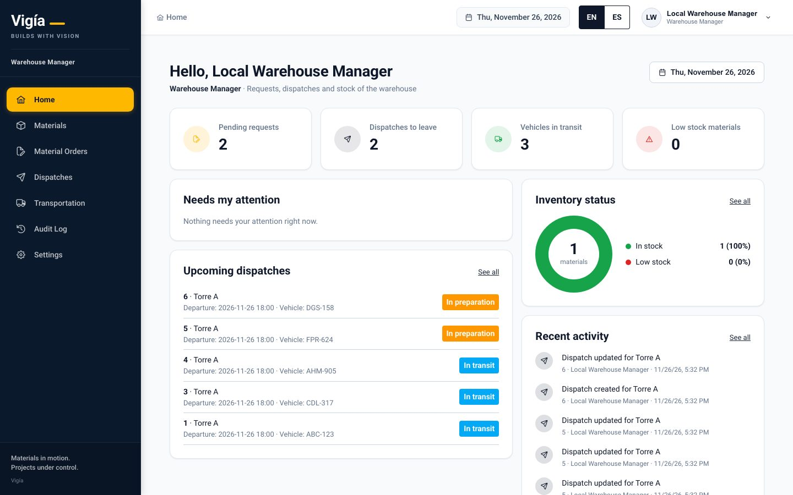

**Figura 2.** Solicitudes de materiales.

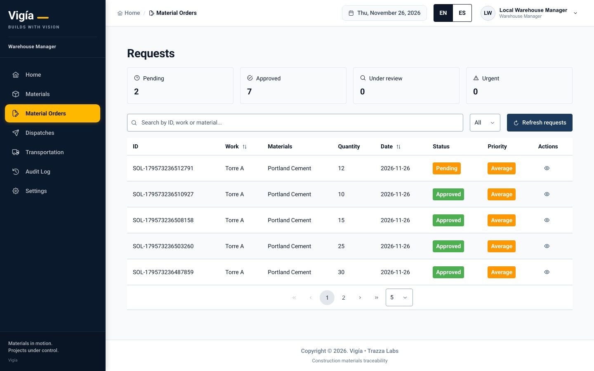

**Figura 3.** Despachos con pesaje, guía y estado.

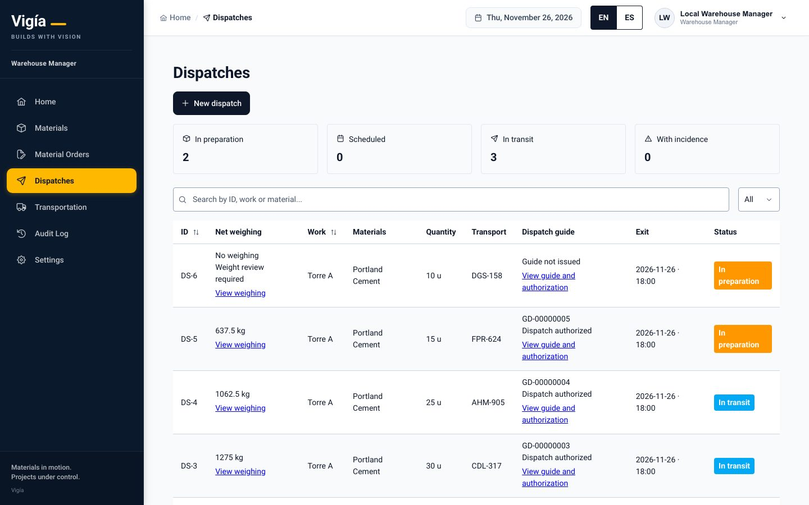

**Figura 4.** Pesaje neto registrado dentro de la tolerancia.

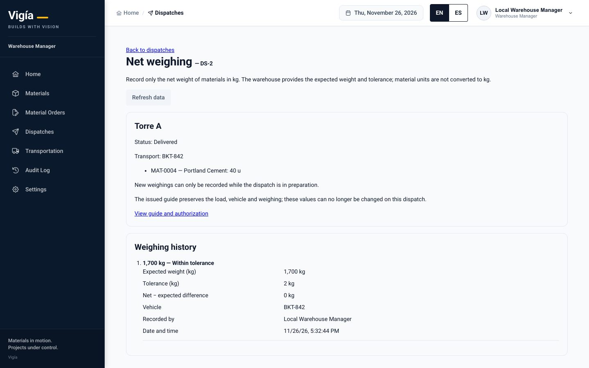

**Figura 5.** Guía de despacho y autorización de salida.

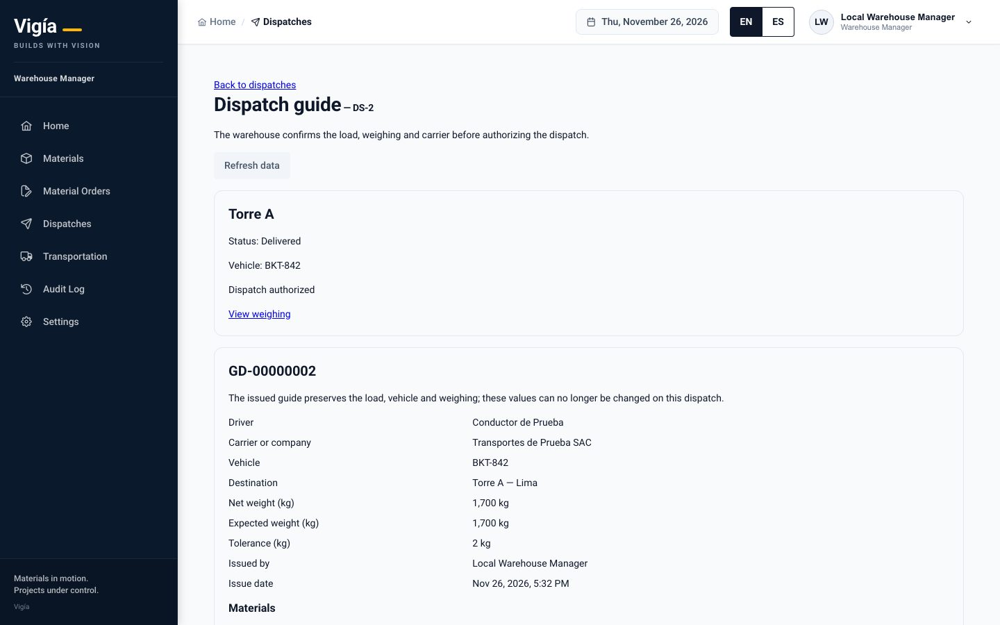

**Figura 6.** Formulario de inicio de traslado con el dispositivo GPS vinculado.

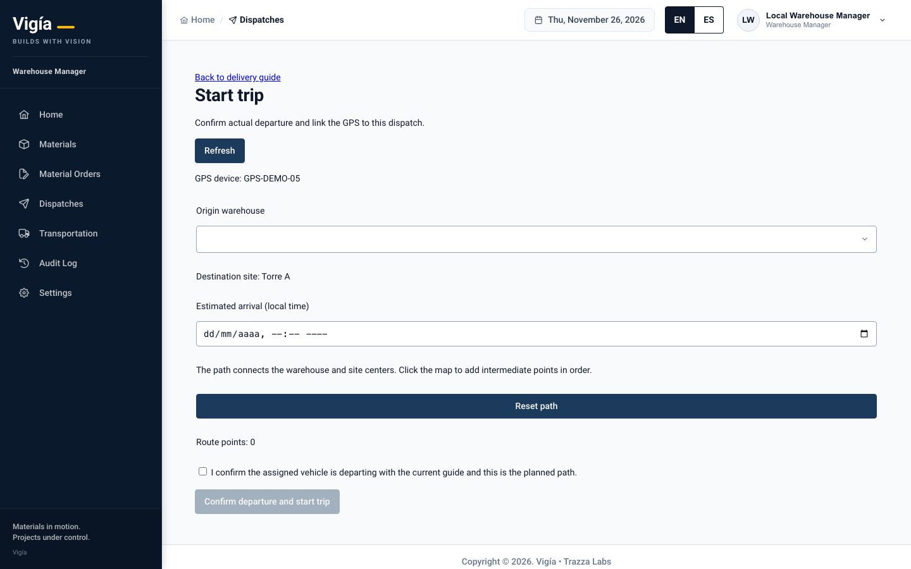

**Figura 7.** Unidades de transporte y dispositivos GPS.

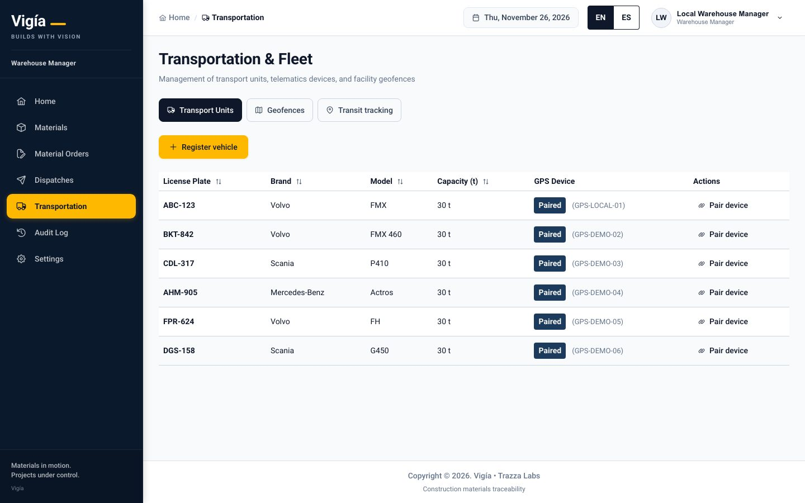

**Figura 8.** Seguimiento de rutas en tránsito.

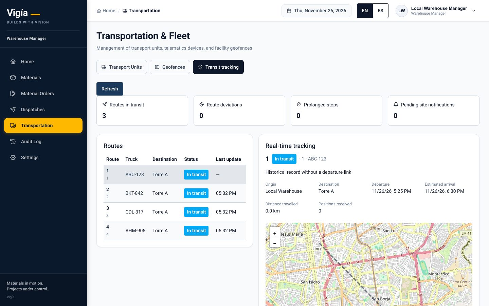

**Residente de obra**

**Figura 9.** Nueva solicitud de materiales para un proyecto asignado.

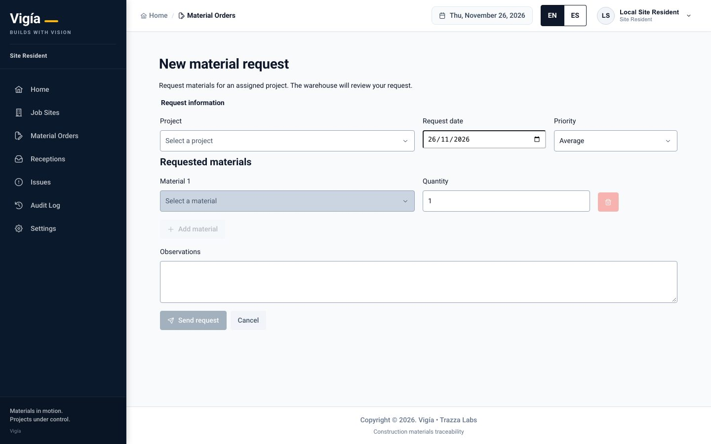

**Figura 10.** Recepciones y comparación de cantidades.

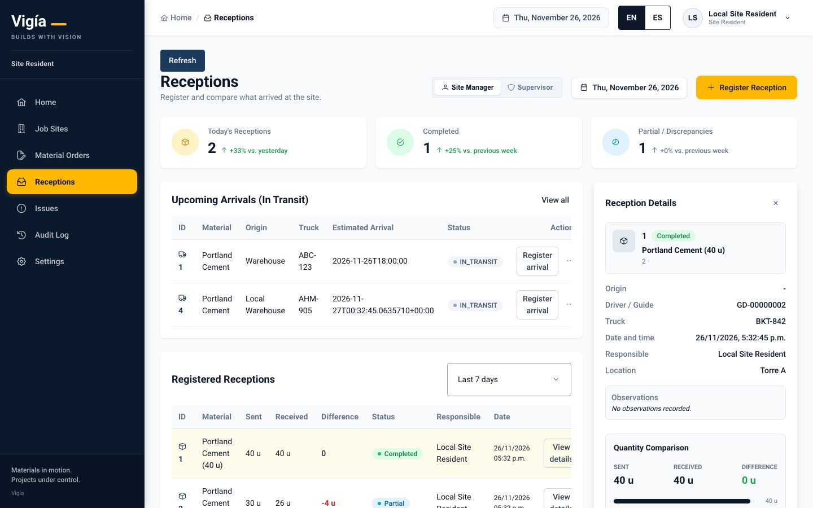

**Figura 11.** Registro de la recepción de un despacho en tránsito.

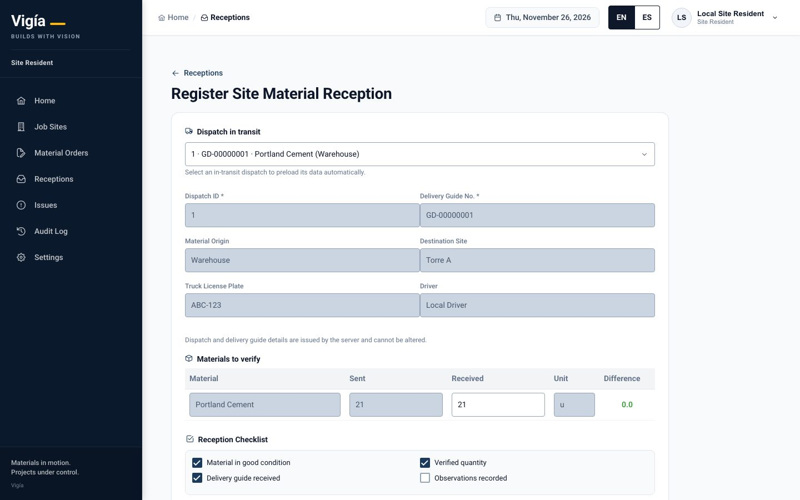

**Figura 12.** Lista de casos de discrepancia.

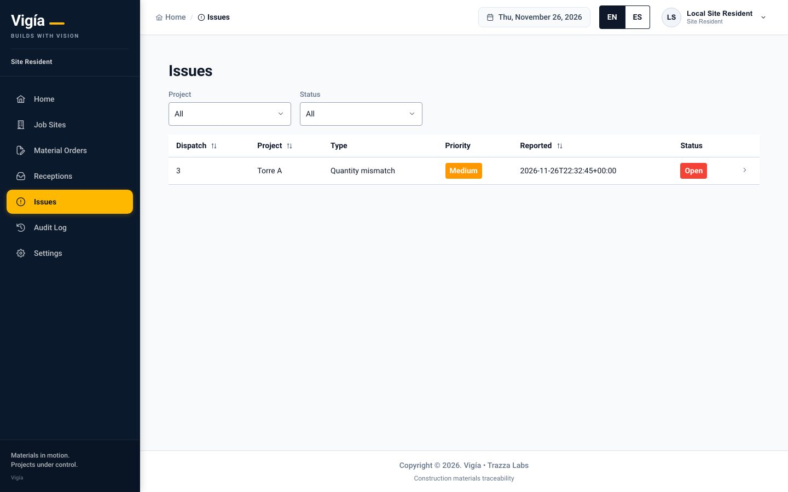

**Figura 13.** Detalle del caso con línea de tiempo y evidencia (imagen de muestra).

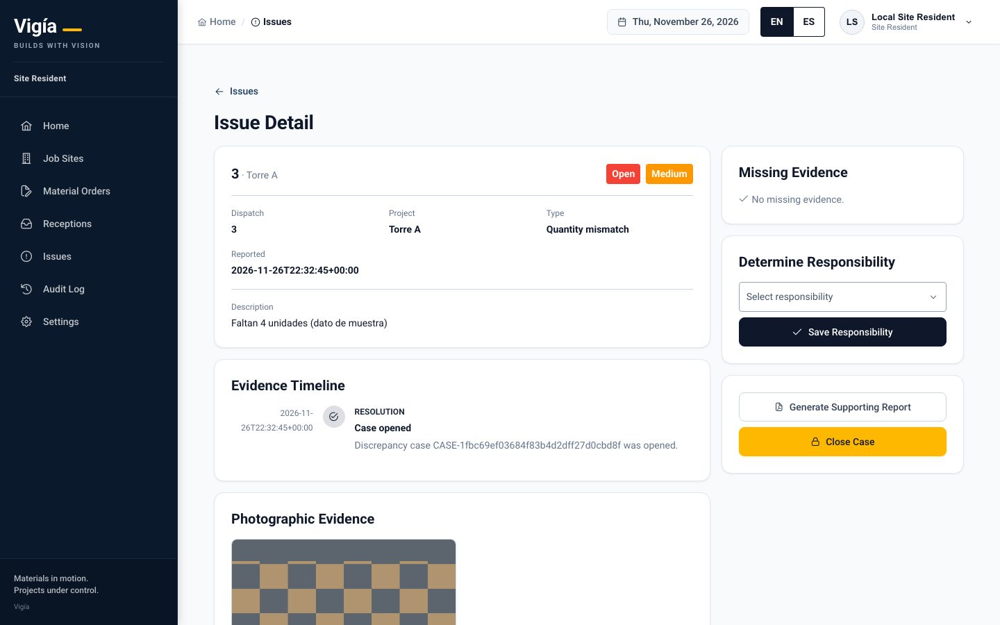

**Supervisor (administrador)**

**Figura 14.** Vista general de la operación.

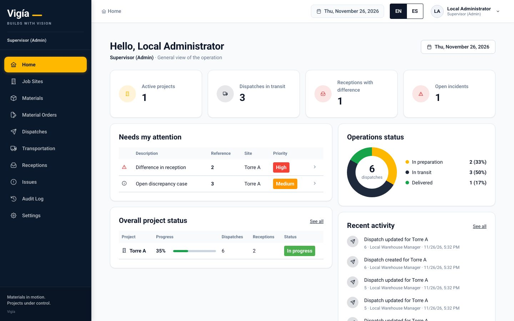

**Figura 15.** Historial de actividad.

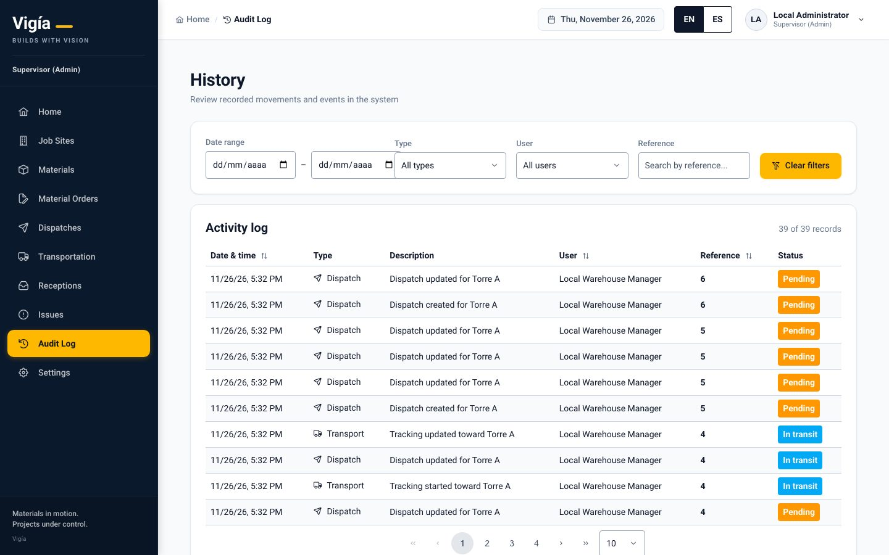

**Landing Page**

**Figura 16.** Formulario de solicitud de suscripción en la versión de `develop`.

**Verificación automatizada (ejecución local del 26/11/2026).** Se ejecutaron los scripts de verificación del repositorio `vigia-platform` contra el API local:

| Alcance | Script | Comprobaciones HTTP aprobadas |
|---|---|---|
| Autenticación, roles, persistencia, pedidos, telemetría, recepciones y casos | `verify-local.py` | 85 |
| Pedido de materiales del residente | `verify-resident-orders.py` | 42 |
| Pesaje neto y tolerancia | `verify-dispatch-weighing.py` | 79 |
| Guía de despacho | `verify-dispatch-guides.py` | 67 |
| Flota y geocercas | `verify-fleet-geofences.py` | 55 (más 4 concurrentes) |
| Salida y seguimiento GPS | `verify-dispatch-transit.py` | 88 |
| Flujo de pedido a despacho | `verify-order-dispatch-flow.py` | 33 |
| Integración de la recepción | `verify-reception-integration.py` | 84 |
| Fotografías de evidencia | `verify-evidence-files.py` | 106 |

En la Web Application pasaron las 34 pruebas unitarias (`node --test scripts/*.test.mjs`) y la compilación con Vite terminó sin errores. Dos scripts no se completaron: `verify-contact-requests.py` envía el campo `email` al iniciar sesión, mientras que el API espera `username`; y `verify-role-access.py` se detiene en `POST /api/v1/contact-requests`, un endpoint público incorporado el 26/11/2026.

🟢 **Pendiente:** actualizar los dos scripts señalados y agregar el enlace al video que muestra la navegación y la ejecución, publicado en Microsoft Stream.
