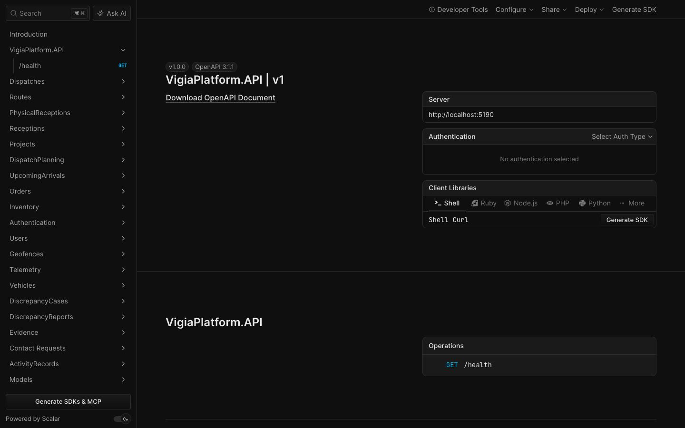
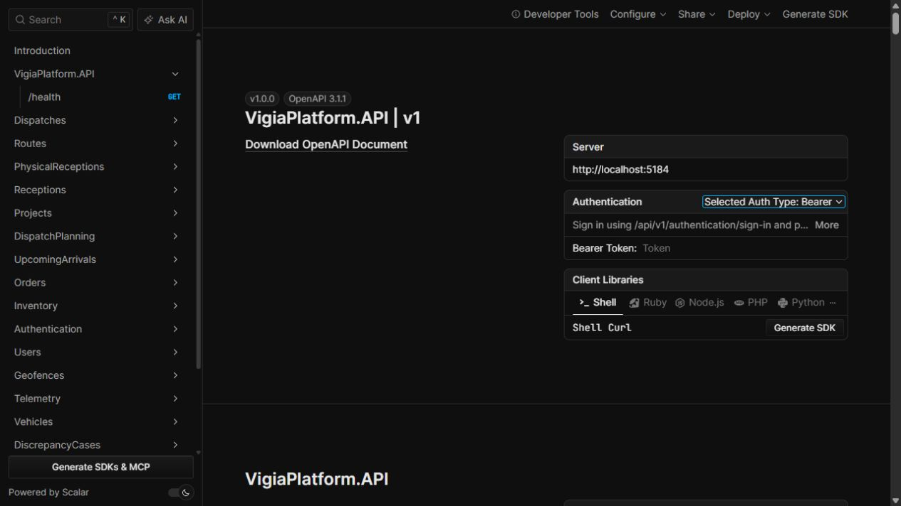
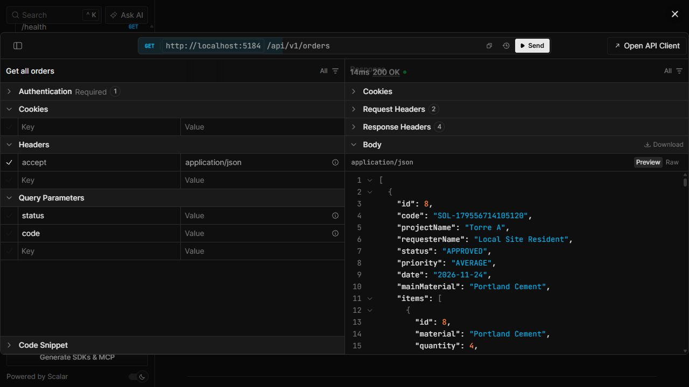
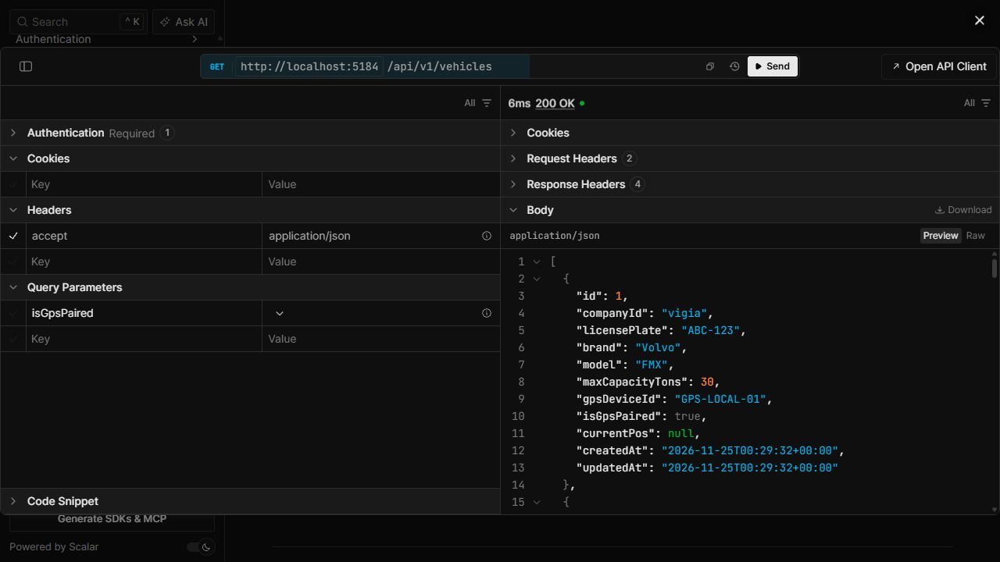
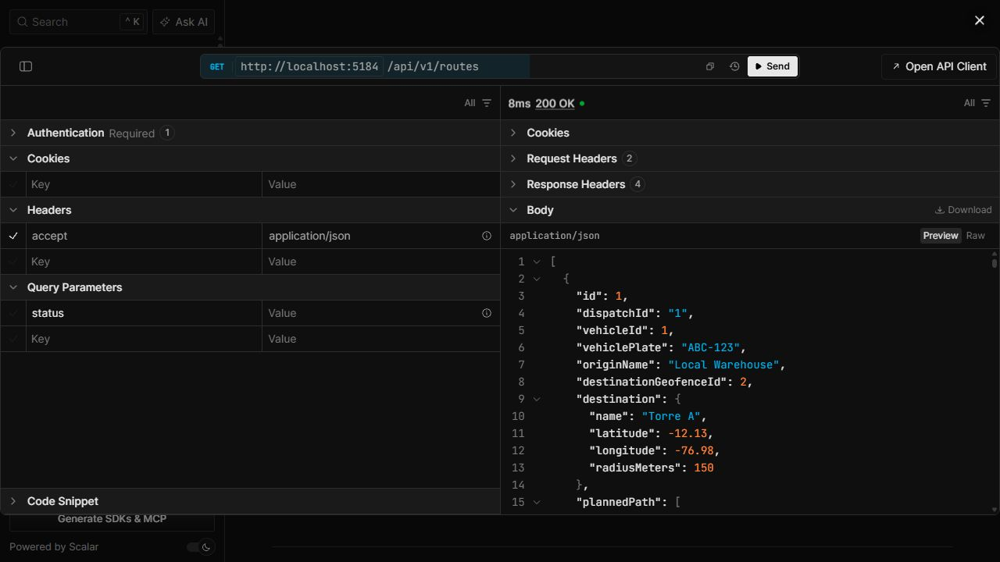
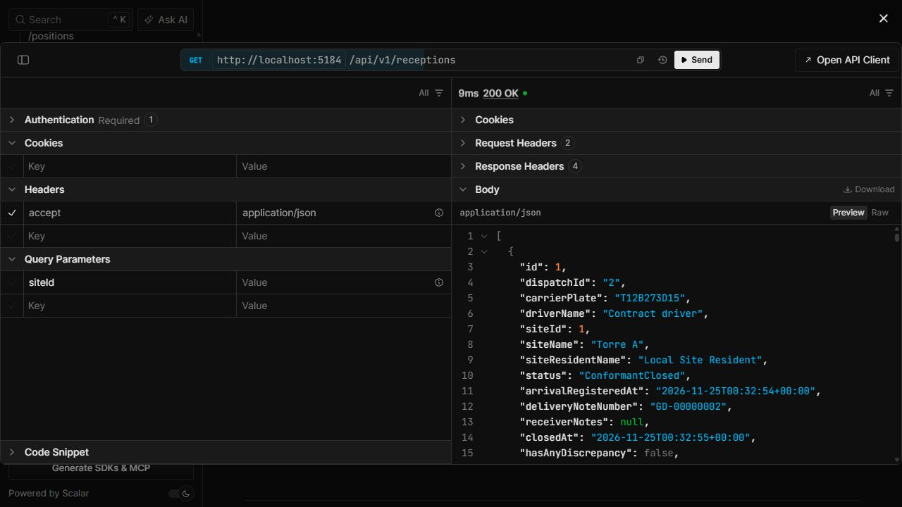
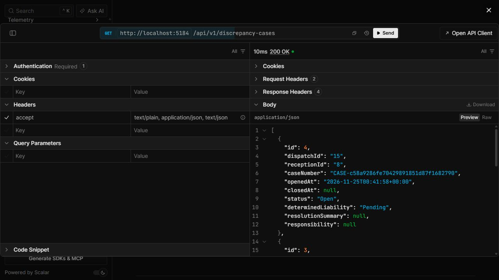
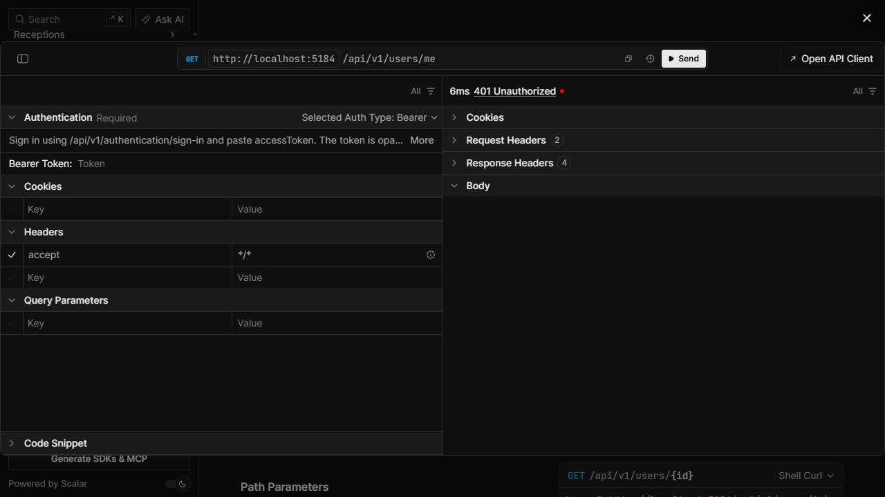
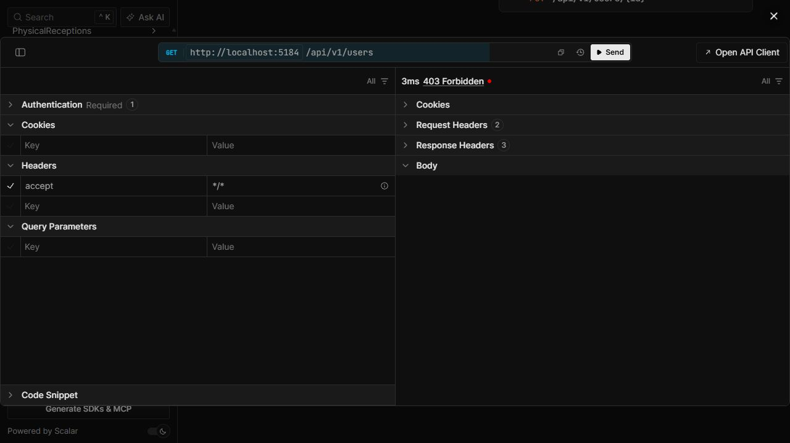

##### 5.2.4.6. Services Documentation Evidence for Sprint Review

El RESTful API se documenta con OpenAPI y se consulta de forma interactiva con Scalar, que en el Sprint 4 incorporó la autenticación Bearer para los endpoints protegidos. El documento OpenAPI de `develop` (`db41a4d`) describe **79 operaciones**; **16** son nuevas respecto de la versión 1.0.0 del Sprint 3.

**Repositorio de Web Services:** https://github.com/upc-pre-202620-1asi0730-8084-Developers/vigia-platform

**Documentación (ejecución local):** `http://localhost:5125/scalar/v1`, y el documento OpenAPI en `http://localhost:5125/openapi/v1.json`.

**Commits de documentación del Sprint:** `c7b9966` (autenticación Bearer en Scalar), `ce0eee6` (autenticación heredada en OpenAPI y límites por rol), `efc241d` y `d420e6c` (revisiones de flota, geocercas y telemetría) y `b2c0c60` (prioridades de integración).

Los códigos de la columna *Respuestas* son los declarados en el documento OpenAPI. Los endpoints protegidos responden además `401` sin token válido y `403` o `404` cuando el rol o el proyecto no corresponden.

###### VigiaPlatform.API

| Verbo | Endpoint | Acción | Parámetros | Respuestas | Sprint 4 |
|---|---|---|---|---|---|
| GET | `/health` | Comprobar la conexión con la base de datos | — | 200 | — |

###### Dispatches

| Verbo | Endpoint | Acción | Parámetros | Respuestas | Sprint 4 |
|---|---|---|---|---|---|
| GET | `/api/v1/dispatches/{dispatchId}/departure` | Consultar los datos para iniciar el traslado | `dispatchId` (ruta) | 200, 404 | Nuevo |
| POST | `/api/v1/dispatches/{dispatchId}/departure` | Confirmar la salida y crear la ruta con GPS | `dispatchId` (ruta); Cuerpo: `originGeofenceId`, `estimatedArrival`, `plannedPath`, `requestId` | 201, 400, 404, 409 | Nuevo |
| POST | `/api/v1/dispatches/{dispatchId}/delivery-guide` | Emitir la guía de despacho | `dispatchId` (ruta); Cuerpo: `driverName`, `carrierName`, `requestId` | 201, 400, 401, 403, 404, 409 | Nuevo |
| GET | `/api/v1/dispatches/{dispatchId}/delivery-guide` | Consultar la guía de despacho | `dispatchId` (ruta) | 200, 404 | Nuevo |
| GET | `/api/v1/dispatches` | Listar despachos | `status` (query), `departureDate` (query), `relatedOrderId` (query) | 200 | — |
| POST | `/api/v1/dispatches` | Crear un despacho | Cuerpo: `projectName`, `siteId`, `address`, `departureDate`, `estimatedTime`, `relatedOrderId`, `dispatchType`, `priority`, `createdBy`, `internalReference`, `observations`, `items` | 201, 400, 409 | — |
| GET | `/api/v1/dispatches/{dispatchId}` | Consultar un despacho | `dispatchId` (ruta) | 200, 404 | — |
| POST | `/api/v1/dispatches/{dispatchId}/items` | Agregar un ítem | `dispatchId` (ruta); Cuerpo: `code`, `material`, `quantity`, `unit`, `observation`, `performedBy` | 200, 400, 404, 409 | — |
| DELETE | `/api/v1/dispatches/{dispatchId}/items/{itemId}` | Quitar un ítem | `dispatchId` (ruta), `itemId` (ruta); Cuerpo: `performedBy` | 200, 404, 409 | — |
| PUT | `/api/v1/dispatches/{dispatchId}/vehicle` | Asignar vehículo | `dispatchId` (ruta); Cuerpo: `vehicleId`, `vehiclePlate`, `performedBy` | 200, 400, 404, 409 | — |
| PATCH | `/api/v1/dispatches/{dispatchId}/status` | Cambiar el estado | `dispatchId` (ruta); Cuerpo: `status`, `performedBy`, `description` | 200, 400, 404, 409 | — |
| POST | `/api/v1/dispatches/{dispatchId}/cancellation` | Cancelar el despacho | `dispatchId` (ruta); Cuerpo: `reason`, `performedBy` | 200, 404, 409 | — |
| POST | `/api/v1/dispatches/{dispatchId}/weighing` | Registrar el pesaje neto | `dispatchId` (ruta); Cuerpo: `weightKg`, `expectedWeightKg`, `toleranceKg`, `requestId` | 201, 400, 404, 409 | Nuevo |
| GET | `/api/v1/dispatches/{dispatchId}/weighing` | Consultar el historial de pesajes | `dispatchId` (ruta) | 200, 404 | Nuevo |
| GET | `/api/v1/dispatches/{dispatchId}/weighing/{weighingId}` | Consultar un pesaje | `dispatchId` (ruta), `weighingId` (ruta) | 200, 404 | Nuevo |

###### Routes

| Verbo | Endpoint | Acción | Parámetros | Respuestas | Sprint 4 |
|---|---|---|---|---|---|
| GET | `/api/v1/routes` | Listar rutas | `status` (query) | 200, 400 | — |
| POST | `/api/v1/routes` | Registrar una ruta | Cuerpo: `dispatchId`, `vehicleId`, `vehiclePlate`, `originName`, `destinationGeofenceId`, `destination`, `plannedPath`, `startedAt`, `estimatedArrival`, `deviationThresholdMeters`, `stopThresholdMinutes` | 201, 400, 409 | — |
| GET | `/api/v1/routes/{routeId}` | Consultar una ruta | `routeId` (ruta) | 200, 404 | — |
| GET | `/api/v1/routes/{routeId}/alerts` | Listar alertas de una ruta | `routeId` (ruta) | 200, 404 | — |
| POST | `/api/v1/routes/{routeId}/positions` | Registrar una posición | `routeId` (ruta); Cuerpo: `latitude`, `longitude`, `speedKmh`, `reportedAt` | 200, 400, 404, 409 | — |
| POST | `/api/v1/routes/{routeId}/signal-lost` | Marcar pérdida de señal | `routeId` (ruta) | 200, 404, 409 | — |
| POST | `/api/v1/routes/{routeId}/alerts/{alertId}/notify` | Notificar una alerta | `routeId` (ruta), `alertId` (ruta) | 200, 404, 409 | — |

###### PhysicalReceptions

| Verbo | Endpoint | Acción | Parámetros | Respuestas | Sprint 4 |
|---|---|---|---|---|---|
| POST | `/api/v1/receptions/physical` | Registrar la recepción física | Cuerpo: `dispatchId`, `deliveryGuideNumber`, `driverName`, `items`, `checklist`, `observations`, `requestId` | 200 | — |
| POST | `/api/v1/receptions/{id}/verify` | Verificar y cerrar la recepción | `id` (ruta); Cuerpo: `status`, `checklist`, `observations`, `requestId` | 200 | — |
| PUT | `/api/v1/receptions/{id}` | Actualizar una recepción | `id` (ruta); Cuerpo: `dispatchId`, `deliveryGuideNumber`, `driverName`, `items`, `checklist`, `observations`, `requestId` | 200 | — |
| POST | `/api/v1/receptions/{id}/compare` | Comparar cantidades | `id` (ruta); Cuerpo: `items` | 200 | — |

###### Receptions

| Verbo | Endpoint | Acción | Parámetros | Respuestas | Sprint 4 |
|---|---|---|---|---|---|
| GET | `/api/v1/receptions/{id}` | Consultar una recepción | `id` (ruta) | 200, 404 | — |
| POST | `/api/v1/receptions/arrivals` | Registrar la llegada de una unidad | Cuerpo: `dispatchId`, `carrierPlate`, `driverName`, `siteId`, `siteName`, `siteResidentName`, `items` | 201, 400 | — |
| POST | `/api/v1/receptions` | Registrar una recepción | Cuerpo: `dispatchId`, `carrierPlate`, `driverName`, `siteId`, `siteName`, `siteResidentName`, `items` | 201, 400 | — |
| GET | `/api/v1/receptions` | Listar recepciones | `siteId` (query) | 200 | — |
| GET | `/api/v1/receptions/upcoming-arrivals` | Listar próximas llegadas | — | 200 | — |
| GET | `/api/v1/receptions/by-dispatch/{dispatchId}` | Consultar la recepción de un despacho | `dispatchId` (ruta) | 200, 404 | — |
| POST | `/api/v1/receptions/{id}/confirm` | Confirmar el recibo con pesaje y firma | `id` (ruta); Cuerpo: `deliveryNoteNumber`, `grossWeightKg`, `tareWeightKg`, `weighingSlipNumber`, `isSealIntact`, `isDeliveryNotePhysicalOk`, `isScaleCalibrated`, `checklistRemarks`, `signatureData`, `signedBy`, `receiverNotes` | 200, 400, 404 | — |
| POST | `/api/v1/receptions/{id}/verify-material` | Verificar un material | `id` (ruta); Cuerpo: `materialId`, `receivedQuantity`, `comments` | 200, 400, 404 | — |
| POST | `/api/v1/receptions/{id}/conformity` | Registrar conformidad | `id` (ruta); Cuerpo: `complianceNotes` | 200, 400, 404 | — |
| POST | `/api/v1/receptions/{id}/discrepancy` | Reportar una discrepancia | `id` (ruta); Cuerpo: `reason`, `description`, `severity` | 200, 400, 404, 409 | — |
| POST | `/api/v1/receptions/{id}/evidence` | Adjuntar una referencia de evidencia | `id` (ruta); Cuerpo: `evidenceType`, `fileUrl`, `description` | 200, 400, 404 | — |

###### Projects

| Verbo | Endpoint | Acción | Parámetros | Respuestas | Sprint 4 |
|---|---|---|---|---|---|
| GET | `/api/v1/projects` | Listar proyectos | — | 200 | — |

###### DispatchPlanning

| Verbo | Endpoint | Acción | Parámetros | Respuestas | Sprint 4 |
|---|---|---|---|---|---|
| POST | `/api/v1/dispatches/from-order` | Crear un despacho desde un pedido | Cuerpo: `projectName`, `relatedOrderId`, `departureDate`, `estimatedTime`, `dispatchType`, `priority`, `observations` | 200 | — |

###### UpcomingArrivals

| Verbo | Endpoint | Acción | Parámetros | Respuestas | Sprint 4 |
|---|---|---|---|---|---|
| GET | `/api/v1/upcoming-arrivals` | Listar llegadas para la obra asignada | — | 200 | — |

###### Orders

| Verbo | Endpoint | Acción | Parámetros | Respuestas | Sprint 4 |
|---|---|---|---|---|---|
| GET | `/api/v1/orders` | Listar pedidos | `status` (query), `code` (query) | 200, 400 | — |
| POST | `/api/v1/orders` | Crear un pedido | Cuerpo: `code`, `projectName`, `requesterName`, `priority`, `date`, `mainMaterial`, `observations`, `items`, `attachedFiles` | 201, 400, 409 | — |
| GET | `/api/v1/orders/{orderId}` | Consultar un pedido | `orderId` (ruta) | 200, 404 | — |
| POST | `/api/v1/orders/{orderId}/attached-files` | Adjuntar un archivo | `orderId` (ruta); Cuerpo: `name`, `type`, `sizeInBytes`, `performedBy` | 200, 400, 404, 409 | — |
| PATCH | `/api/v1/orders/{orderId}/status` | Cambiar el estado del pedido | `orderId` (ruta); Cuerpo: `status`, `performedBy`, `description` | 200, 400, 404, 409 | — |
| GET | `/api/v1/orders/request-catalog` | Consultar el catálogo solicitable | — | 200 | Nuevo |
| POST | `/api/v1/orders/requests` | Enviar una solicitud de materiales | Cuerpo: `projectId`, `priority`, `date`, `items`, `observations` | 201, 400, 403, 409 | Nuevo |

###### Inventory

| Verbo | Endpoint | Acción | Parámetros | Respuestas | Sprint 4 |
|---|---|---|---|---|---|
| GET | `/api/v1/materials` | Listar materiales | — | 200 | — |
| GET | `/api/v1/inventory-movements` | Listar movimientos de inventario | — | 200 | — |

###### Authentication

| Verbo | Endpoint | Acción | Parámetros | Respuestas | Sprint 4 |
|---|---|---|---|---|---|
| POST | `/api/v1/authentication/sign-in` | Iniciar sesión | Cuerpo: `username`, `password` | 200 | — |
| POST | `/api/v1/authentication/sign-up` | Registrar una cuenta | Cuerpo: `username`, `password` | 200 | — |

###### Users

| Verbo | Endpoint | Acción | Parámetros | Respuestas | Sprint 4 |
|---|---|---|---|---|---|
| GET | `/api/v1/users` | Listar usuarios | — | 200 | — |
| GET | `/api/v1/users/me` | Consultar la cuenta actual | — | 200 | — |
| GET | `/api/v1/users/{id}` | Consultar un usuario | `id` (ruta) | 200 | — |
| PUT | `/api/v1/users/{id}` | Actualizar el perfil | `id` (ruta); Cuerpo: `fullName`, `email`, `phone`, `timezone` | 200 | — |

###### Geofences

| Verbo | Endpoint | Acción | Parámetros | Respuestas | Sprint 4 |
|---|---|---|---|---|---|
| GET | `/api/v1/geofences` | Listar geocercas | `type` (query) | 200, 400 | — |
| POST | `/api/v1/geofences` | Definir una geocerca | Cuerpo: `companyId`, `siteId`, `name`, `type`, `centerPoint`, `latitude`, `longitude`, `radiusMeters` | 201, 400, 409 | — |
| GET | `/api/v1/geofences/{id}` | Consultar una geocerca | `id` (ruta) | 200, 404 | — |

###### Telemetry

| Verbo | Endpoint | Acción | Parámetros | Respuestas | Sprint 4 |
|---|---|---|---|---|---|
| POST | `/api/v1/telemetry/reports` | Recibir un reporte del dispositivo GPS | Cuerpo: `gpsDeviceId`, `latitude`, `longitude`, `timestamp`, `speedKmh` | 200, 400, 409 | — |

###### Vehicles

| Verbo | Endpoint | Acción | Parámetros | Respuestas | Sprint 4 |
|---|---|---|---|---|---|
| GET | `/api/v1/vehicles` | Listar vehículos | `isGpsPaired` (query) | 200 | — |
| POST | `/api/v1/vehicles` | Registrar un vehículo | Cuerpo: `companyId`, `licensePlate`, `brand`, `model`, `maxCapacityTons`, `gpsDeviceId` | 201, 400, 409 | — |
| GET | `/api/v1/vehicles/{id}` | Consultar un vehículo | `id` (ruta) | 200, 404 | — |
| POST | `/api/v1/vehicles/{id}/gps-device` | Vincular un dispositivo GPS | `id` (ruta); Cuerpo: `gpsDeviceId` | 200, 400, 404, 409 | — |
| POST | `/api/v1/vehicles/{id}/position` | Actualizar la posición | `id` (ruta); Cuerpo: `latitude`, `longitude` | 200, 400, 404 | — |

###### DiscrepancyCases

| Verbo | Endpoint | Acción | Parámetros | Respuestas | Sprint 4 |
|---|---|---|---|---|---|
| GET | `/api/v1/discrepancy-cases` | Listar casos | — | 200 | — |
| POST | `/api/v1/discrepancy-cases` | Abrir un caso | Cuerpo: `dispatchId`, `receptionId`, `caseNumber` | 201, 400 | — |
| GET | `/api/v1/discrepancy-cases/{id}` | Consultar un caso | `id` (ruta) | 200, 404 | — |
| PATCH | `/api/v1/discrepancy-cases/{id}` | Determinar responsabilidad o cerrar | `id` (ruta); Cuerpo: `responsibility`, `status`, `resolutionSummary` | 200, 400, 404, 409 | — |
| GET | `/api/v1/discrepancy-cases/{id}/timeline` | Consultar la línea de tiempo | `id` (ruta) | 200, 404 | — |
| GET | `/api/v1/discrepancy-cases/{id}/reception` | Consultar la recepción del caso | `id` (ruta) | 200 | Nuevo |

###### DiscrepancyReports

| Verbo | Endpoint | Acción | Parámetros | Respuestas | Sprint 4 |
|---|---|---|---|---|---|
| GET | `/api/v1/discrepancy-cases/{id}/report` | Descargar el reporte PDF | `id` (ruta) | 200 | — |

###### Evidence

| Verbo | Endpoint | Acción | Parámetros | Respuestas | Sprint 4 |
|---|---|---|---|---|---|
| GET | `/api/v1/receptions/{receptionId}/evidence-context` | Consultar evidencias de una recepción | `receptionId` (ruta) | 200 | Nuevo |
| POST | `/api/v1/receptions/{receptionId}/evidence/files` | Subir una fotografía | `receptionId` (ruta); Cuerpo: `file`, `description`, `requestId` (`multipart/form-data`) | 201, 400, 404, 409, 413 | Nuevo |
| GET | `/api/v1/receptions/{receptionId}/evidence/files/{fileId}` | Descargar una fotografía | `receptionId` (ruta), `fileId` (ruta) | 200 | Nuevo |

###### Contact Requests

| Verbo | Endpoint | Acción | Parámetros | Respuestas | Sprint 4 |
|---|---|---|---|---|---|
| POST | `/api/v1/contact-requests` | Enviar una solicitud de suscripción | Cuerpo: `fullName`, `companyName`, `email`, `segment`, `message`, `phone`, `plan`, `requestId` | 201, 400, 409 | Nuevo |
| GET | `/api/v1/contact-requests` | Listar solicitudes de contacto | — | 200, 401, 403 | Nuevo |
| GET | `/api/v1/contact-requests/{id}` | Consultar una solicitud de contacto | `id` (ruta) | 200, 401, 403, 404 | Nuevo |

###### ActivityRecords

| Verbo | Endpoint | Acción | Parámetros | Respuestas | Sprint 4 |
|---|---|---|---|---|---|
| GET | `/api/v1/activity-records` | Consultar el historial de actividad | — | 200 | — |

###### Ejemplos de solicitud y respuesta

Ejemplos obtenidos de la ejecución local del 26/11/2026 con datos de muestra.

**Registro del pesaje neto** — `POST /api/v1/dispatches/2/weighing` → `201`

El servidor compara el peso con el esperado y la tolerancia, y devuelve la diferencia y el estado de la comparación.

Solicitud:

```json
{
  "weightKg": 1700,
  "expectedWeightKg": 1700,
  "toleranceKg": 2
}
```

Respuesta (extracto):

```json
{
  "id": 2,
  "dispatchId": 2,
  "weightBasis": "NET",
  "weightKg": 1700,
  "expectedWeightKg": 1700,
  "toleranceKg": 2,
  "differenceKg": 0,
  "comparisonStatus": "WITHIN_TOLERANCE",
  "requiresReview": false
}
```

**Emisión de la guía de despacho** — `POST /api/v1/dispatches/2/delivery-guide` → `201`

La guía guarda una copia de la carga, el vehículo y el pesaje, y autoriza la salida.

Solicitud:

```json
{
  "driverName": "Conductor de Prueba",
  "carrierName": "Transportes de Prueba SAC"
}
```

Respuesta (extracto):

```json
{
  "dispatchId": 2,
  "guideNumber": "GD-00000002",
  "projectName": "Torre A",
  "siteId": "1",
  "address": "Lima",
  "relatedOrderId": "4",
  "driverName": "Conductor de Prueba",
  "carrierName": "Transportes de Prueba SAC",
  "vehicleId": 2
}
```

**Reporte del dispositivo GPS** — `POST /api/v1/telemetry/reports` → `200`

El API asocia el reporte a la ruta activa del dispositivo e indica su estado.

Solicitud:

```json
{
  "gpsDeviceId": "GPS-DEMO-02",
  "latitude": -12.105,
  "longitude": -77.005,
  "speedKmh": 32,
  "timestamp": "2026-11-26T22:32:44.735195+00:00"
}
```

Respuesta (extracto):

```json
{
  "accepted": true,
  "tracked": true,
  "replayed": false,
  "vehicleId": 2,
  "routeId": 2,
  "dispatchId": "2",
  "status": "IN_TRANSIT"
}
```

**Solicitud de suscripción** — `POST /api/v1/contact-requests` → `201`

Endpoint público que guarda la solicitud con estado `RECEIVED`.

Solicitud:

```json
{
  "fullName": "Persona de Prueba",
  "companyName": "Constructora de Prueba",
  "email": "contacto@example.com",
  "segment": "CONSTRUCTION",
  "message": "Solicitud de muestra",
  "requestId": "d0eb3d52-e0a0-4bcb-bfa7-5f5df50481f8"
}
```

Respuesta (extracto):

```json
{
  "id": 1,
  "requestId": "d0eb3d52-e0a0-4bcb-bfa7-5f5df50481f8",
  "fullName": "Persona de Prueba",
  "companyName": "Constructora de Prueba",
  "email": "contacto@example.com",
  "phone": null,
  "segment": "CONSTRUCTION",
  "plan": null,
  "message": "Solicitud de muestra"
}
```

###### Capturas de la documentación

**Figura 1.** Documentación Scalar del API en `develop`, con el selector de autenticación.



**Figura 2.** Esquema de autenticación Bearer. (Evidencia registrada por el equipo en `vigia-platform`.)



**Figura 3.** Consulta de pedidos con respuesta `200`. (Evidencia registrada por el equipo en `vigia-platform`.)



**Figura 4.** Consulta de vehículos con respuesta `200`. (Evidencia registrada por el equipo en `vigia-platform`.)



**Figura 5.** Consulta de rutas con respuesta `200`. (Evidencia registrada por el equipo en `vigia-platform`.)



**Figura 6.** Recepciones del residente con respuesta `200`. (Evidencia registrada por el equipo en `vigia-platform`.)



**Figura 7.** Casos del residente con respuesta `200`. (Evidencia registrada por el equipo en `vigia-platform`.)



**Figura 8.** Solicitud sin autenticación rechazada con `401`. (Evidencia registrada por el equipo en `vigia-platform`.)



**Figura 9.** Rol sin permiso rechazado con `403`. (Evidencia registrada por el equipo en `vigia-platform`.)


