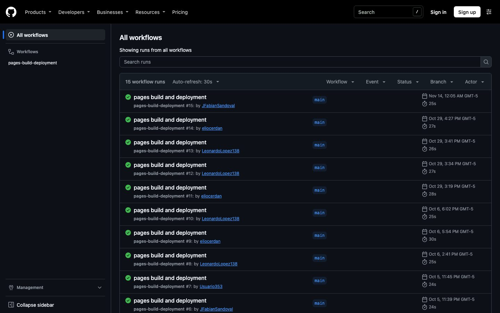
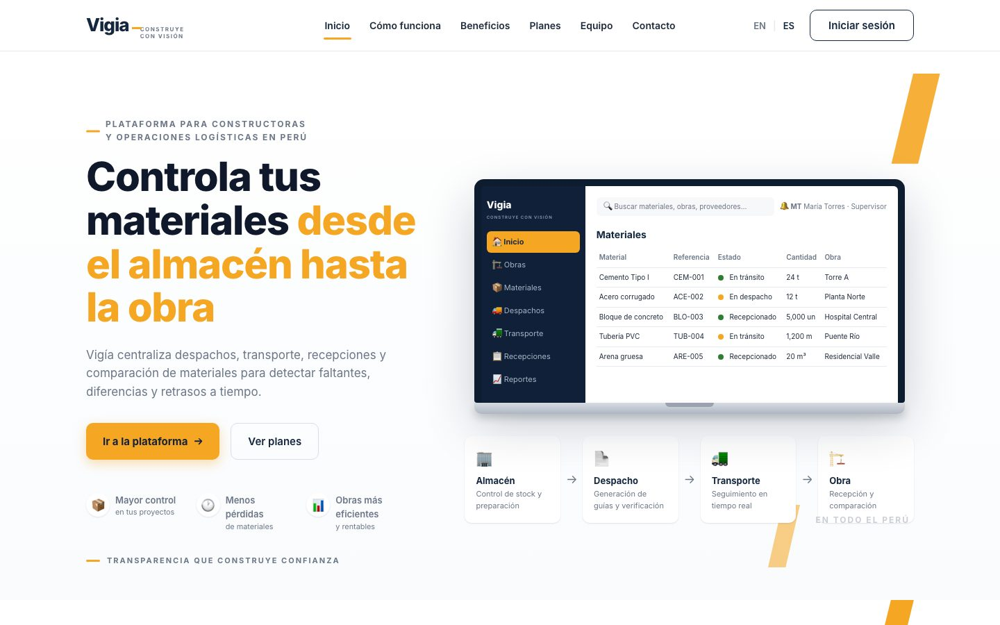
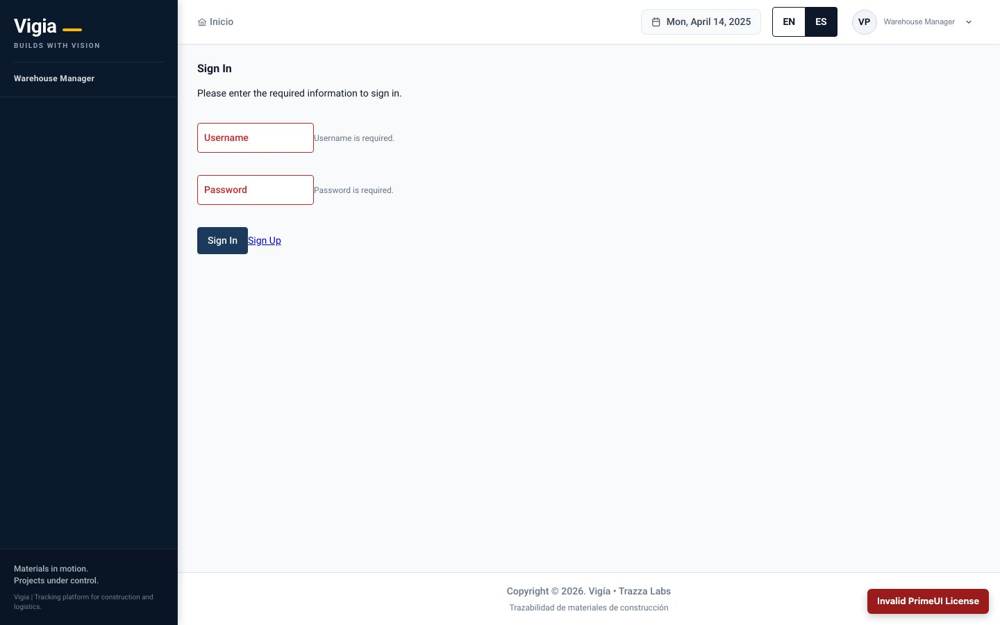

##### 5.2.4.7. Software Deployment Evidence for Sprint Review

Esta sección resume el estado de despliegue de los tres productos al 26 de noviembre de 2026. Durante el Sprint 4 se preparó la publicación, pero **todavía no se ha publicado una versión nueva**: el trabajo del Sprint está integrado en `develop` y las versiones públicas corresponden al 14 de noviembre de 2026.

| Producto | Plataforma | URL pública | Versión publicada | Estado al 26/11/2026 |
|---|---|---|---|---|
| Landing Page | GitHub Pages | https://upc-pre-202620-1asi0730-8084-developers.github.io/vigia-website/ | `v1.1.0` (`a327eb1`) | Disponible; sin el formulario de contacto de `develop` |
| Frontend Web Application | Firebase Hosting | https://vigia-frontend-8084.web.app | `v2.1.0` | Disponible; muestra el aviso de licencia de PrimeUI |
| Web Services (RESTful API) | Máquina virtual en Azure | https://vigia-api-8084.northcentralus.cloudapp.azure.com | `v1.0.0` | No respondió a la comprobación |

**Preparación realizada en el Sprint 4.**

- Migraciones de Entity Framework Core para los cambios de pedidos, pesaje, guía, recepción y contacto, que deben aplicarse antes de iniciar la nueva versión del API.
- Política CORS del API ampliada con el origen del Landing Page en GitHub Pages.
- Configuración de la clave de PrimeUI para la compilación de producción de la Web Application (commit `10d889e`).
- Autenticación Bearer en la documentación Scalar (commit `c7b9966`).

**Figura 1.** Ejecuciones de GitHub Pages del repositorio `vigia-website`; la más reciente es del 14 de noviembre.

**Figura 2.** Landing Page publicado, capturado el 26/11/2026.

**Figura 3.** Web Application publicada en Firebase Hosting, capturada el 26/11/2026.

🟢 **Pendiente:** publicar las versiones finales de los tres productos, verificar el API en Azure y agregar las capturas de la migración, el despliegue y la verificación (tasks `S4-10` y `S4-11`).
