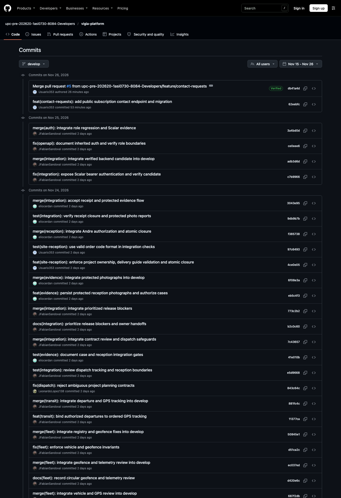
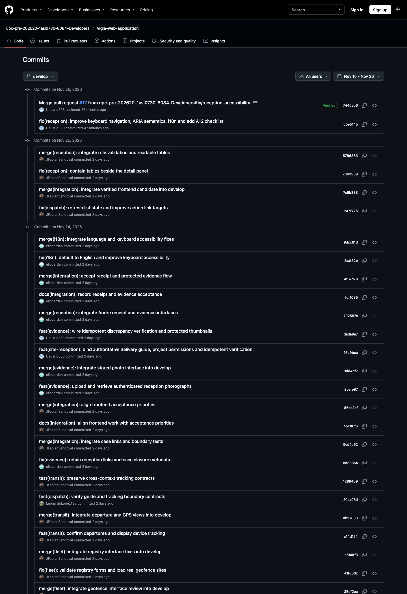
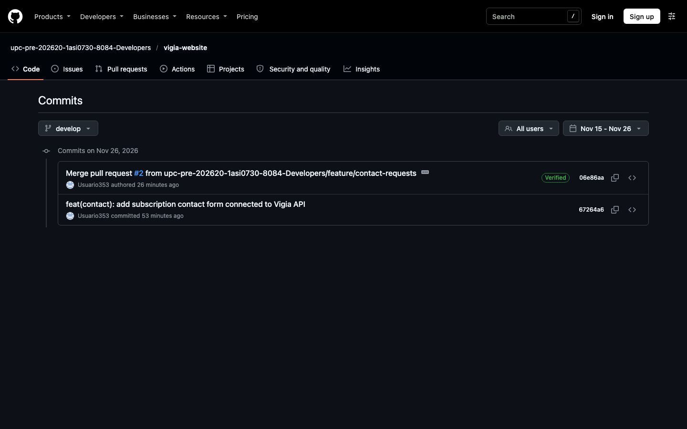

##### 5.2.4.8. Team Collaboration Insights during Sprint

Esta subsección documenta la colaboración del equipo durante el Sprint 4, con corte al 26 de noviembre de 2026. El trabajo se desarrolló en ramas `feature/*` y `fix/*` integradas a `develop` bajo GitFlow y Conventional Commits, con la participación de los cuatro integrantes activos señalados en la sección 5.2.4.1.

**Participación por integrante (commits en `develop` desde el 2026-11-15, sin fusiones).**

| Team Member | GitHub Username | `vigia-platform` | `vigia-web-application` | `vigia-website` |
|---|---|---|---|---|
| Sandoval Cueto, Fabián | `JFabianSandoval` | 8 | 8 | 0 |
| Lopez, Leonardo | `LeonardoLopez138` | 5 | 5 | 0 |
| Cárdenas Huaman, Mathias | `Usuario353` | 3 | 4 | 1 |
| Ramos Cerdán, Elías | `eliocerdan` | 3 | 4 | 0 |
| **Total** | | **19** | **21** | **1** |

El gráfico *Contributors* de GitHub solo considera la rama `main`, que a la fecha de corte no incorpora el trabajo del Sprint 4; por ello se presenta el historial de commits de `develop`.

**Figura 1.** Fragmento del historial de commits de vigia-platform (rama develop).

**Figura 2.** Fragmento del historial de commits de vigia-web-application (rama develop).

**Figura 3.** Historial de commits de vigia-website (rama develop).

🟢 **Pendiente:** actualizar las cifras y las capturas al cierre del Sprint (2026-11-29).
