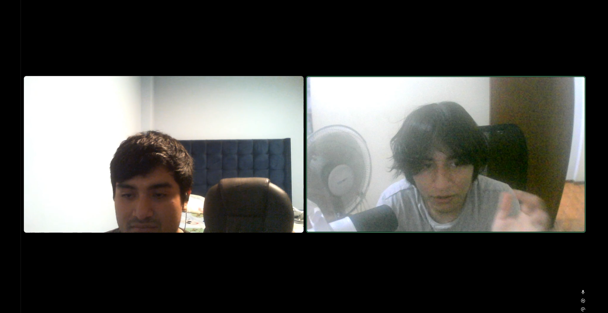
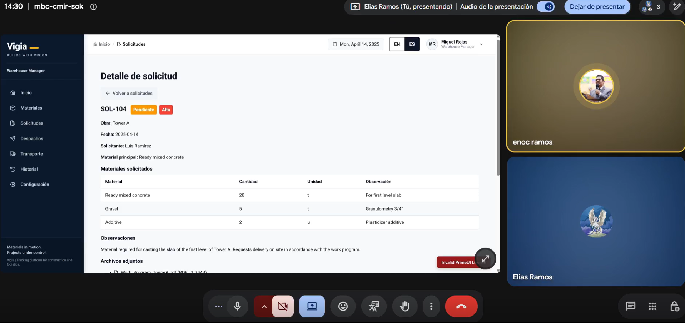
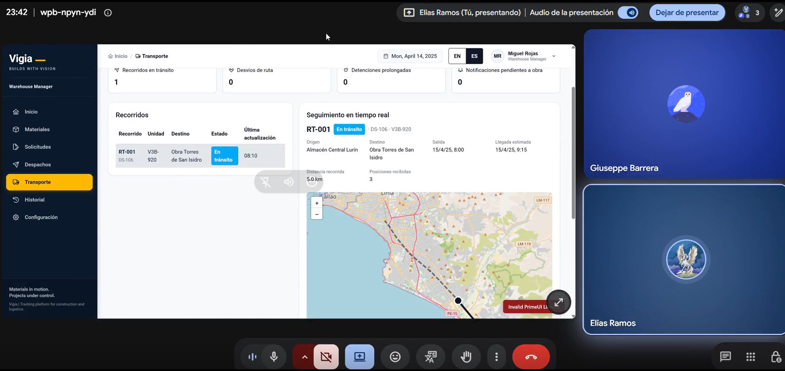

#### 5.3.2. Registro de Entrevistas

A continuación se consigna la información de cada entrevistado, agrupada por segmento objetivo, junto con un resumen descriptivo de las apreciaciones sobre las tareas asignadas durante la sesión de validación. Conforme a lo indicado en el Anexo C del enunciado del proyecto, las sesiones se registran en video y su consolidación constituye el video de validación, que incluye un título por entrevista con el nombre del entrevistado, el segmento objetivo y la fecha. Se requieren de tres a cinco entrevistas por segmento.

> **Nota sobre el estado de esta sección.** Las sesiones de validación del Sprint 3 se realizan con el Landing Page y la Web Application. Cada entrada conserva el formato del registro de la sección 2.2.2 y se completa con los datos reales del entrevistado, especificaciones del dispositivo de prueba, su grabación y su enlace. Esta sección no incluye entradas ilustrativas: los campos marcados con 🟢 se reemplazan con el dato real al registrar cada sesión.
>
> **Video de validación:** `upc-pre-202620-1asi0730-8084-trazzalabs-validation-sprint-3.mp4`. 🟢 *Enlace de Microsoft Stream: completar al publicar el video consolidado.*

##### Segmento 1: Empresas Constructoras e Inmobiliarias (Gestión Técnica y de Obra)

| Entrevistado:          | Clara Esperanza Laureano De la Cruz |
|------------------------|------------------------------------------------------|
| Duración               | 32:38 *(evaluación formal: 07:28)* |
| Género                 | Femenino |
| Edad                   | 24 |
| Distrito de residencia | Lima |
| Estado civil           | Soltera |
| Ocupación              | *(Responsable de Obra / Gestión Técnica de Proyectos)* |
| Objetivos              | Monitorear el abastecimiento en obra en tiempo real, evitar retrasos por faltantes de material y contar con respaldo fotográfico de recepciones. |
| Dispositivo de prueba  | Laptop Workstation Dell Precision 5570 (Intel Core i7-12800H, 32 GB RAM DDR5, 1 TB SSD NVMe, NVIDIA RTX A1000 4GB, pantalla 15.6" UHD+, Wi-Fi 6). Hardware de alto rendimiento para planos CAD/BIM y plataformas web simultáneas. |
| Fecha de la entrevista | *(12/11/2026)* |
| Inicio en el video consolidado | *(25:10)* |
| Captura                |  |
| Url:                   | [Ver video en SharePoint](https://upcedupe-my.sharepoint.com/:v:/g/personal/u202316353_upc_edu_pe/IQA4K3p9pMHUSJ0W4TcW80WnAXXTQaMFiGcmPoK1pR5QAgo) |

**Resumen de la entrevista 1**

Durante la sesión de validación, la entrevistada interactuó con la plataforma asumiendo el rol de responsable de obra, destacando la alta visibilidad y claridad del estado de los despachos en tránsito, lo que le permitió identificar con rapidez el último movimiento registrado de las unidades hacia la obra. Valoró especialmente que las cantidades de materiales recibidos frente a los despachados se presenten de forma directa y visual, señalando que esta funcionalidad es crítica para detectar faltantes oportunamente, evitar retrasos en el cronograma de ejecución y respaldar cualquier discrepancia física mediante el adjunto de evidencias fotográficas, evitando disputas entre el transportista y el personal de campo. Asimismo, consideró indispensable la sección de avisos prioritarios para focalizar la atención en incidentes graves que puedan generar sobrecostos imprevistos, aunque como oportunidad de mejora identificó la necesidad de corregir ciertas etiquetas aún en idioma inglés (como los avisos de llegadas previstas) y optimizar la carga del mapa interactivo de geolocalización.

| Entrevistado:          | Gianmarco Jiménez |
|------------------------|------------------------------------------------------|
| Duración               | 12:41 *(evaluación formal: 03:16)* |
| Género                 | Masculino |
| Edad                   | 25 |
| Distrito de residencia | Lima |
| Estado civil           | Soltero |
| Ocupación              | *(Supervisor de Empresa Constructora / Gestión de Proyectos)* |
| Objetivos              | Priorizar incidencias operativas críticas en obra, asegurar trazabilidad histórica y resolver discrepancias con evidencias concretas. |
| Dispositivo de prueba  | Laptop Workstation Lenovo ThinkPad P16s (AMD Ryzen 7 PRO 7840U, 32 GB RAM LPDDR5x, 1 TB SSD NVMe, AMD Radeon 780M / GPU dedicada, pantalla 16" WQXGA, fibra óptica 200 Mbps). Capaz de ejecutar programas de ingeniería y software SaaS en paralelo. |
| Fecha de la entrevista | *(13/11/2026)* |
| Inicio en el video consolidado | *(09:25)* |
| Captura                |  |
| Url:                   | [Ver video en SharePoint](https://upcedupe-my.sharepoint.com/:v:/g/personal/u202316353_upc_edu_pe/IQBDz3ytXsL_SZnGNEjC_6c8ASTTJ35I-5mrNHm28wbmMz4) |

**Resumen de la entrevista 2**

En la evaluación realizada, el entrevistado analizó los flujos de gestión de incidencias y supervisión de obras en la plataforma Vigía, manifestando que el sistema de alertas tempranas y avisos permite reconocer de forma inmediata aquellas situaciones operativas que demandan una intervención urgente, facilitando la priorización del trabajo técnico. Resaltó que el nivel de detalle y contexto provisto en la descripción de cada caso (como el registro de discrepancias en entregas de materiales) resulta suficiente para comprender la raíz del problema antes de tomar decisiones en obra, enfatizando el valor de respaldar cada evento con evidencias fotográficas concretas para evitar ambigüedades. Finalmente, valoró positivamente la claridad en la asignación de responsabilidades y la funcionalidad de filtrado cronológico en el historial de incidentes, subrayando que esta trazabilidad histórica es fundamental para auditar resoluciones pasadas y optimizar los procesos de abastecimiento en proyectos futuros.

| Entrevistado:          | *Owen Aguirre Campos*                                                            |
|------------------------|----------------------------------------------------------------------------------|
| Duración               | *8:26*                                                                           |
| Género                 | Masculino                                                                        |
| Edad                   | 26                                                                               |
| Distrito de residencia | Lima                                                                             |
| Estado civil           | Soltero                                                                          |
| Ocupación              | *Gestor de proyectos*                                                            |
| Objetivos              | Priorizar su optimizacion de tiempo y recursos en su trabajo                     |
| Fecha de la entrevista | *(13/11/2026)*                                                                   |
| Inicio en el video consolidado | *0:00*                                                                           |
| Captura                |  |
| Url:                   | https://upcedupe-my.sharepoint.com/:v:/g/personal/u20241a649_upc_edu_pe/IQCVfBDA6LJiRr1Ax88Ndc6tAVpeF9hvLHgSOAL6bcxfifg?e=lXaz1I&nav=eyJyZWZlcnJhbEluZm8iOnsicmVmZXJyYWxBcHAiOiJTdHJlYW1XZWJBcHAiLCJyZWZlcnJhbFZpZXciOiJTaGFyZURpYWxvZy1MaW5rIiwicmVmZXJyYWxBcHBQbGF0Zm9ybSI6IldlYiIsInJlZmVycmFsTW9kZSI6InZpZXcifX0%3D                                         |

**Resumen de la entrevista 3**
Durante la validación de la plataforma Vigía como responsable de obra, Owen Aguirre Campos destacó que los avisos prioritarios y alertas tempranas permiten identificar de inmediato situaciones críticas para priorizar el trabajo técnico y evitar sobrecostos. Asimismo, valoró la claridad en la trazabilidad de los despachos en tránsito y la comparación directa entre materiales enviados y recibidos, señalando que el respaldo con evidencias fotográficas y el historial cronológico resultan fundamentales para resolver discrepancias sin ambigüedades, auditar incidentes y optimizar futuros abastecimientos. Finalmente, identificó como oportunidades de mejora la traducción completa de ciertas etiquetas aún en inglés y la optimización en el tiempo de carga del mapa de geolocalización.

##### Segmento 2: Empresas de Logística, Transporte y Almacenes Satélite

| Entrevistado:          | *(Enoc Javier Ramos Chumpitaz)*                                                                                                                                                                      |
|------------------------|------------------------------------------------------------------------------------------------------------------------------------------------------------------------------------------------------|
| Duración               | *(08:39)*                                                                                                                                                                                            |
| Género                 | Masculino                                                                                                                                                                                            |
| Edad                   | 48                                                                                                                                                                                                   |
| Distrito de residencia | La Victoria                                                                                                                                                                                          |
| Estado civil           | Casado, tres hijos                                                                                                                                                                                   |
| Ocupación              | *(Coordinador de despacho y transporte de materiales)*                                                                                                                                               |
| Objetivos              | Cumplir los despachos a tiempo, reducir errores y reclamos por diferencias entre lo enviado y lo recibido, y mantener un mejor control de la información durante todo el traslado de los materiales. |
| Fecha de la entrevista | *(12/11/2026)*                                                                                                                                                                                       |
| Inicio en el video consolidado | *(00:00)*                                                                                                                                                                                            |
| Captura                |                                                                                 |
| Url:                   | *(https://n9.cl/fe5x5x)*                                                                                                                                                                             |

**Resumen de la entrevista 4**

 *Durante la entrevista de validación, Enoc mostró una percepción positiva de la plataforma Vigía, destacando que el sistema presenta información clara sobre los despachos, los estados de entrega y el control de materiales. Pudo consultar detalles de los envíos, revisar el historial de despachos y reconocer la información de los transportistas sin mayores inconvenientes. Además, consideró útil la opción de registrar observaciones o incidentes durante el traslado para mantener informados a los involucrados.
 Sin embargo, se identificaron algunas oportunidades de mejora. Principalmente, sería conveniente simplificar la visualización de los datos en pantallas con mucha información y optimizar la actualización en tiempo real de los estados de entrega, de manera que los coordinadores de despacho puedan conocer rápidamente cualquier cambio en la ruta. Estas mejoras permitirían agilizar el seguimiento de los despachos y reducir la necesidad de coordinaciones adicionales por otros medios.
 En general, Enoc consideró que Vigía cuenta con una interfaz comprensible y fácil de utilizar, aunque todavía se pueden ajustar algunos aspectos visuales para facilitar el trabajo diario.*

| Entrevistado:          | *(Angel Giuseppe Barrera Romero)*                                                                                                                                                                   |
|------------------------|-----------------------------------------------------------------------------------------------------------------------------------------------------------------------------------------------------|
| Duración               | *(09:39)*                                                                                                                                                                                           |
| Género                 | Masculino                                                                                                                                                                                           |
| Edad                   | 40                                                                                                                                                                                                  |
| Distrito de residencia | Ate                                                                                                                                                                                                 |
| Estado civil           | Soltero                                                                                                                                                                                             |
| Ocupación              | *(Jefe de almacén central)*                                                                                                                                                                         |
| Objetivos              | Organizar los despachos de materiales de manera rápida y ordenada, reducir errores y retrasos, centralizar la información de cada despacho y contar con evidencias claras de cada etapa del proceso. |
| Fecha de la entrevista | *(12/11/2026)*                                                                                                                                                                                      |
| Inicio en el video consolidado | *(00:00)*                                                                                                                                                                                           |
| Captura                |                                                                                  |
| Url:                   | *(https://n9.cl/28u6x)*                                                                                                                                                                             |

**Resumen de la entrevista 5**

 *Durante la entrevista de validación, Ángel mostró una percepción positiva de la plataforma Vigía, destacando que las secciones de solicitudes, inventario, despachos y transporte presentan información clara y organizada. Pudo identificar solicitudes pendientes, consultar materiales disponibles y reconocer el estado de los despachos sin mayores dificultades. También consideró útil contar con diferentes opciones para aprobar, solicitar correcciones o rechazar pedidos.
 Sin embargo, se identificaron algunas oportunidades de mejora. Principalmente, sería conveniente resaltar los datos más importantes de cada solicitud y agregar alertas más visibles para los materiales con pocas existencias, de manera que los responsables de almacén puedan reconocer rápidamente posibles problemas de stock. Estas mejoras permitirían agilizar la revisión de pedidos y reducir el riesgo de errores durante las operaciones.
 En general, Ángel consideró que Vigía cuenta con una interfaz comprensible y fácil de utilizar, aunque todavía se pueden mejorar algunos elementos visuales para facilitar el trabajo diario.*

| Entrevistado:          |  *(nombres y apellidos de la persona entrevistada)* |
|------------------------|-------------------------------------------------------|
| Duración               |  *(mm:ss de la sesión editada)* |
| Género                 |  |
| Edad                   |  |
| Distrito de residencia |  |
| Estado civil           |  |
| Ocupación              |  *(cargo y empresa)* |
| Objetivos              |  |
| Fecha de la entrevista |  *(dd/mm/aaaa)* |
| Inicio en el video consolidado |  *(hh:mm:ss dentro del video de validación)* |
| Captura                |  *(captura de un cuadro del video, en assets/chapther-5/entrevistas-validacion/)* |
| Url:                   |  *(enlace privado de Microsoft Stream)* |

**Resumen de la entrevista 6**

🟢 *Pendiente: realizar la tercera entrevista del segmento (mínimo de 3 por segmento). Redactar de forma descriptiva las principales apreciaciones del entrevistado sobre las tareas asignadas (sección 5.3.1): qué tareas completó sin ayuda, en qué pantalla dudó o se equivocó, cuánto tardó y qué respondió a la pregunta de cada tarea.*

Debe incluirse al menos un testimonio positivo por segmento, que se reutiliza en el Video About-the-Product (sección 5.4). Las observaciones que surjan de estas sesiones se evalúan con el formato de heurísticas en la sección 5.3.3.
