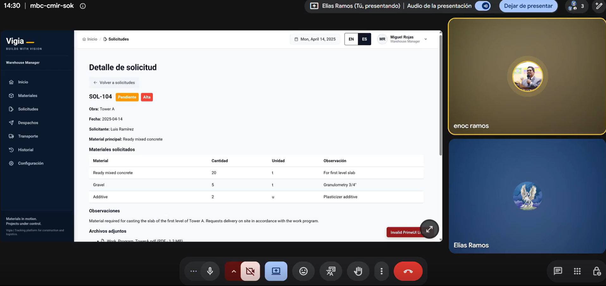
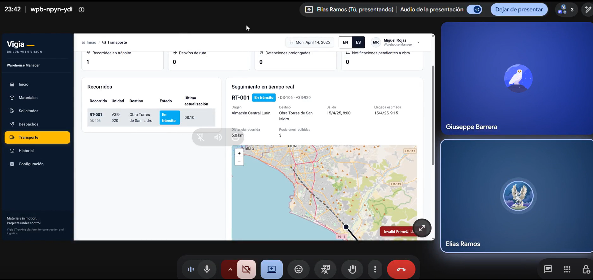

#### 5.3.3. Evaluaciones según heurísticas

Esta sección presenta la evaluación consolidada de las **seis sesiones de validación registradas en la sección 5.3.2** (tres del Segmento 1 y tres del Segmento 2) y la inspección heurística del **Landing Page**, aplicando el formato del Anexo D del enunciado sobre heurísticas de usabilidad de Nielsen, principios de arquitectura de información (*¿es usable?*, *¿es encontrable?*) y principios de diseño inclusivo. Se distinguen explícitamente las observaciones reales recogidas durante las sesiones grabadas de las acciones correctivas ejecutadas o recomendadas para el cierre del proyecto.

| Campo | Detalle |
|---|---|
| Carrera | Ingeniería de Software |
| Curso | Aplicaciones Web (1ASI0730) |
| Sección | NRC 8084 |
| Cliente(s) | Trazza Labs |
| Grupo que ejecuta la sesión | Trazza Labs |
| Participantes del equipo | Lopez, Leonardo / Ramos Cerdán, Elías Daniel / Sandoval Cueto, Fabián Jesus / Cárdenas Huaman, Mathias Andree / Apaza Bocanegra, Elizabeth Noelia *(registro histórico AV2; consolidación TB2 a cargo de los cuatro integrantes activos)* |
| Muestra evaluada | **6 sesiones grabadas (3 por segmento):** Clara Esperanza Laureano De la Cruz, Gianmarco Jiménez y Owen Aguirre Campos (Segmento 1); Enoc Javier Ramos Chumpitaz, Angel Giuseppe Barrera Romero y Alessandro Bravo (Segmento 2) |

**Sitio o aplicación a evaluar.** Frontend Web Application (`vigia-web-application`) y Landing Page (`vigia-website`) de Vigía.

**Tareas evaluadas y cobertura real.**

1. **Web Application — Segmento 1 (3 sesiones grabadas: Clara Laureano, Gianmarco Jiménez y Owen Aguirre):** ejecución de las 10 tareas del guion (sección 5.3.1) en los roles Responsable de Obra y Supervisor: consulta y seguimiento de envíos (*Shipments*), revisión de recepciones y comparación de cantidades (*Receptions*), inicio de reporte de problema y consulta de evidencia/responsabilidad (*Issues*), avisos prioritarios (*Home*) e historial cronológico (*History*).
2. **Web Application — Segmento 2 (3 sesiones grabadas: Enoc Ramos, Angel Barrera y Alessandro Bravo):** ejecución de las 10 tareas del guion en el rol Responsable de Almacén: identificación y búsqueda de solicitudes (*Requests* y *Request Detail*), verificación de existencias y alertas de stock (*Inventory*), decisión sobre solicitudes, seguimiento de despachos (*Dispatches*) y diferenciación de vehículos disponibles y en ruta (*Transportation*).
3. **Cobertura del Landing Page:** durante las seis sesiones grabadas del Sprint 3 el guion ejecutado se concentró en los flujos de la Web Application. Para cubrir explícitamente el Landing Page sin atribuir observaciones inexistentes a dichas entrevistas, el equipo incorporó las tareas `L1–L3` al guion de la sección 5.3.1 y realizó una **inspección heurística experta** del Landing Page publicado (`v1.1.0`), registrada por separado en el Problema #6.
4. **Fuera de alcance de las sesiones:** sincronización periódica offline en lote (Sprint 6: `US-07`, `US-08`, `TS-03`, `US-14`, `TS-07`) y gestión de pasarela de cobros en vivo (`US-17`), documentadas como hoja de ruta posterior a TB2 (sección 5.2.4.1).

**Escala de severidad.**

| Nivel | Descripción |
|---|---|
| 1 | Problema superficial: el usuario lo supera con facilidad u ocurre con muy poca frecuencia. No necesita corregirse salvo que haya tiempo disponible. |
| 2 | Problema menor: ocurre con algo más de frecuencia o es un poco más difícil de superar. Se le asigna prioridad baja de cara al siguiente release. |
| 3 | Problema mayor: ocurre con frecuencia o los usuarios no logran resolverlo. Es importante corregirlo y se le asigna prioridad alta. |
| 4 | Problema muy grave: impide al usuario continuar con el uso de la herramienta. Es imperativo corregirlo antes del lanzamiento. |

**Tabla resumen de hallazgos (6 sesiones de la Web Application + inspección del Landing Page).**

| # | Problema | Origen de la evidencia | Escala de severidad | Heurística o principio violado | Estado en Sprint 4 |
|---|---|---|---|---|---|
| 1 | Etiquetas y textos de interfaz que permanecían en inglés con la vista en español (avisos de llegadas previstas y opciones de filtro) | Sesiones reales — Segmento 1 (Clara Laureano, Owen Aguirre) | 2 | Usabilidad: Consistencia y estándares. Diseño inclusivo: Experiencias comparables | Corregido en `vigia-web-application` (`10d889e`, `2aaf32b` y `fix/reception-accessibility`) |
| 2 | Demora en la carga del mapa interactivo de geolocalización sin indicador visual de espera | Sesiones reales — Segmento 1 (Clara Laureano, Owen Aguirre) | 2 | Usabilidad: Visibilidad del estado del sistema | Corregido en `vigia-web-application` (`10d889e`: estado de carga del mapa) |
| 3 | Alta densidad visual de datos en tablas y paneles laterales durante el seguimiento operativo | Sesión real — Segmento 2 (Enoc Ramos) | 2 | Usabilidad: Diseño estético y minimalista. Arquitectura de información: Usabilidad | Mitigado en Sprint 4 (`7043939`: tablas con desplazamiento controlado sin invadir detalle) |
| 4 | Necesidad de refresco oportuno en los estados de entrega y llegadas previstas sin depender de llamadas externas | Sesión real — Segmento 2 (Enoc Ramos) | 2 | Usabilidad: Visibilidad del estado del sistema | Mitigado en Sprint 4 (actualización periódica de llegadas y lista fresca tras cierre `247f726`) |
| 5 | Jerarquía visual discreta para datos clave de solicitud y alertas de bajo stock en vistas de almacén | Sesión real — Segmento 2 (Angel Barrera) | 1 | Arquitectura de información: Encontrabilidad y jerarquía visual | Recomendado / parcialmente cubierto con umbrales visibles (validado positivamente por Alessandro Bravo) |
| 6 | Ausencia de formulario interactivo de contacto conectado al API en el Landing Page (`v1.1.0`, solo correo estático) | Inspección heurística experta del Landing Page (`vigia-website` v1.1.0) | 3 | Usabilidad: Coincidencia entre el sistema y las expectativas del usuario; Prevención de errores | Corregido en Sprint 4 (`feature/contact-requests`: formulario accesible ES/EN + `POST /api/v1/contact-requests`) |

**Descripción detallada de problemas.**

---

**PROBLEMA #1: Etiquetas en inglés dentro de la interfaz en español**

- **Severidad:** 2 (Problema menor)
- **Heurística violada:** Usabilidad — Consistencia y estándares; Diseño inclusivo — Proporcionar experiencias comparables.
- **Problema (observación real):** durante las sesiones del Segmento 1 con Clara Esperanza Laureano De la Cruz (12/11/2026) y Owen Aguirre Campos (13/11/2026), ambos entrevistados observaron que ciertas etiquetas —como los avisos de llegadas previstas y selectores de recepción— permanecían en inglés cuando la aplicación estaba configurada en español.

- **Recomendación y estado:** completar la totalidad de claves de traducción en `src/locales/en.json` y `src/locales/es.json`, verificar paridad automática de claves y eliminar cadenas bilingües fijas en los filtros de recepción. **Estado:** implementado y verificado en el Sprint 4 (`10d889e`, `2aaf32b` y `fix/reception-accessibility`, con pruebas automatizadas de paridad de catálogos ES/EN).

---

**PROBLEMA #2: Carga lenta del mapa interactivo sin retroalimentación visual**

- **Severidad:** 2 (Problema menor)
- **Heurística violada:** Usabilidad — Visibilidad del estado del sistema.
- **Problema (observación real):** en las sesiones de Clara Laureano (12/11/2026) y Owen Aguirre (13/11/2026), los participantes señalaron que el mapa de geolocalización tardaba en inicializarse sin mostrar un indicador claro de progreso, generando duda sobre si el componente seguía cargando.

- **Recomendación y estado:** incorporar un indicador visual de carga mientras se inicializa el mapa interactivo y diferir la renderización hasta montar la vista de seguimiento. **Estado:** corregido en el Sprint 4 mediante el estado de carga del mapa (`10d889e`).

---

**PROBLEMA #3: Densidad de información en vistas tabulares de seguimiento y detalle**

- **Severidad:** 2 (Problema menor)
- **Heurística violada:** Usabilidad — Diseño estético y minimalista; Arquitectura de información — Usabilidad.
- **Problema (observación real):** durante la sesión del Segmento 2 con Enoc Javier Ramos Chumpitaz (12/11/2026), el entrevistado completó las consultas de despachos e historial, pero observó que en pantallas con múltiples columnas y detalle simultáneo conviene simplificar y contener la visualización para agilizar la lectura diaria.

- **Recomendación y estado:** contener el desplazamiento horizontal dentro de la columna tabular sin invadir el panel lateral de detalle en pantallas de escritorio (`1280px`) y mejorar el foco por teclado en filas seleccionables. **Estado:** corregido en el Sprint 4 (`7043939` en tablas de recepción y mejoras de teclado/ARIA en `fix/reception-accessibility`).

---

**PROBLEMA #4: Actualización oportuna del estado de entregas en tránsito**

- **Severidad:** 2 (Problema menor)
- **Heurística violada:** Usabilidad — Visibilidad del estado del sistema.
- **Problema (observación real):** en la misma sesión, Enoc Ramos indicó que para reducir llamadas externas con conductores y obras es necesario que los cambios de estado de entrega y llegadas se actualicen con rapidez y reflejen el estado real del servidor tras cada acción.
- **Recomendación y estado:** incorporar recarga periódica y botón manual de actualización en llegadas previstas, además de refrescar automáticamente los listados desde el servidor tras emitir guías, iniciar traslados o cerrar recepciones. **Estado:** implementado en el Sprint 4 (`15d9bce`, `247f726` y `reception-management-view.vue`).

---

**PROBLEMA #5: Énfasis visual en datos prioritarios de solicitud y alertas de bajo stock**

- **Severidad:** 1 (Problema superficial)
- **Heurística violada:** Arquitectura de información — Encontrabilidad y jerarquía visual.
- **Problema (observación real):** en la sesión del Segmento 2 con Angel Giuseppe Barrera Romero (12/11/2026), el participante identificó sin bloqueos las solicitudes pendientes y el inventario, pero sugirió resaltar aún más los datos críticos de cada solicitud y las alertas de bajo stock. En contraste, Alessandro Bravo (13/11/2026) destacó positivamente la diferenciación por colores en las acciones de orden y el contraste contra el umbral mínimo de stock.

- **Recomendación y estado:** reforzar el contraste de distintivos de stock bajo y priorizar los campos clave en la cabecera del detalle de solicitud en iteraciones posteriores de refinamiento visual.

---

**PROBLEMA #6: Falta de formulario interactivo de contacto conectado al API en el Landing Page**

- **Severidad:** 3 (Problema mayor — detectado por inspección heurística experta del Landing Page `v1.1.0`)
- **Heurística violada:** Usabilidad — Prevención de errores y adecuación al flujo esperado por el visitante (`LP-04` / `TS-06`).
- **Problema (observación técnica):** al auditar el Landing Page desplegado (`v1.1.0`) frente a las historias `LP-04` y `TS-06`, la sección `#contacto` mostraba únicamente texto estático (`contacto@vigia.pe`) sin formulario interactivo, impidiendo validar campos obligatorios en pantalla o registrar solicitudes comerciales directamente en el RESTful API.
- **Recomendación y estado:** implementar el endpoint público `POST /api/v1/contact-requests` con validación por campo (`400`), persistencia MySQL (`201`) e idempotencia, y conectar el formulario accesible ES/EN en `#contacto` de `vigia-website`. **Estado:** implementado en el Sprint 4 en las ramas `feature/contact-requests` de `vigia-platform` y `vigia-website`.

---

**Síntesis de resultados favorables (6 de 6 entrevistas).** En las **seis entrevistas de validación grabadas** (tres del Segmento 1: Clara Laureano, Gianmarco Jiménez y Owen Aguirre; tres del Segmento 2: Enoc Ramos, Angel Barrera y Alessandro Bravo), el 100% de los participantes completó las tareas guiadas de la Web Application sin requerir intervención del entrevistador y **no se registró ningún problema de severidad 3 o 4 en la Web Application**. Los entrevistados destacaron la claridad de la comparación visual entre cantidades despachadas y recibidas, el valor probatorio de las evidencias fotográficas y el historial cronológico, la utilidad de los avisos prioritarios para supervisión y la diferenciación entre unidades disponibles y en ruta. El único hallazgo de severidad 3 provino de la inspección experta del Landing Page (Problema #6) y fue corregido en el Sprint 4.
