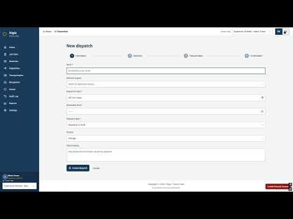

### 5.4. Video About-the-Product

El Video About-the-Product presenta Vigía a los visitantes del Landing Page y a los usuarios de la Web Application. Resume el modelo de negocio de Trazza Labs, las características y los beneficios del producto, e incluye escenas de interacción con la plataforma. El tono es cercano y directo, consistente con el tono de comunicación definido en la sección 4.1: transmite control y confianza sobre el recorrido de los materiales, sin tecnicismos innecesarios.

**Contenido del video.** El video recorre primero el Landing Page de Vigía: los planes de suscripción (plan mensual y plan anual) y la sección del equipo de desarrollo con su video. A continuación muestra la Frontend Web Application: la creación de un nuevo despacho en el asistente de cuatro pasos (información, carga, transporte y confirmación), el registro de una unidad de transporte con su dispositivo GPS y el módulo Transporte y Flota con las unidades vinculadas y sin dispositivo.

**Figura 1.** Captura del Video About-the-Product.

| Dato | Valor |
|---|---|
| Título en YouTube | About the product |
| URL en YouTube (video incrustado en el Landing Page) | https://youtu.be/RjaLFXTpLvg |
| Duración | 03:15 |
| Visibilidad | No listado (se reproduce incrustado en el Landing Page) |
| Nombre del archivo | `upc-pre-202620-1asi0730-8084-trazzalabs-about-the-product-sprint-3.mp4` |
| URL en Microsoft Stream | 🟢 *(completar con el enlace privado de Microsoft Stream)* |

El video está incrustado en la sección *Así funciona Vigía* del Landing Page, en el repositorio `vigia-website`, y su título se traduce al inglés mediante el selector de idioma.

**Aspectos por corregir antes de la entrega.**

- 🟢 *Duración:* el Anexo C del enunciado pide una duración de 1 a 3 minutos y el video dura 3:15. Recortar al menos 15 segundos.
- 🟢 *Testimonio:* el enunciado exige al menos un testimonio positivo de un usuario que participó en las entrevistas de validación. Incorporar un fragmento de las entrevistas de la sección 5.3.2 o confirmar que el video ya lo incluye.
- 🟢 *Título:* el título en YouTube aparece como "Abouth the product". Si se vuelve a subir el video, corregirlo a "About the product". Verificar también que el nombre del archivo en Microsoft Stream siga el Anexo C.
